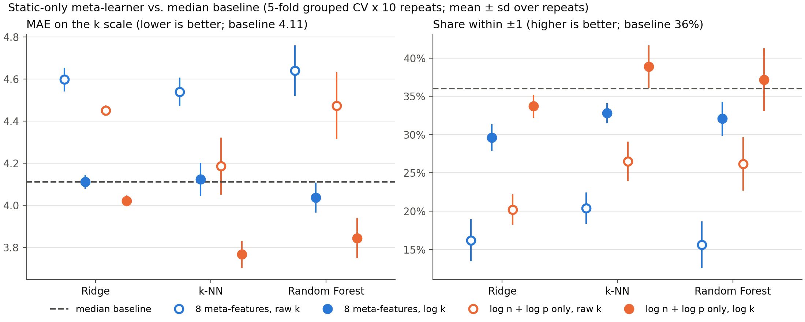
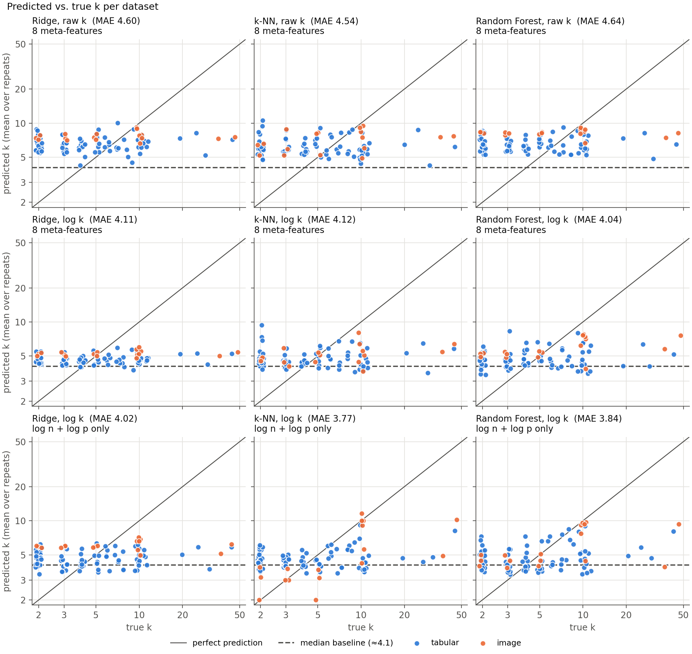
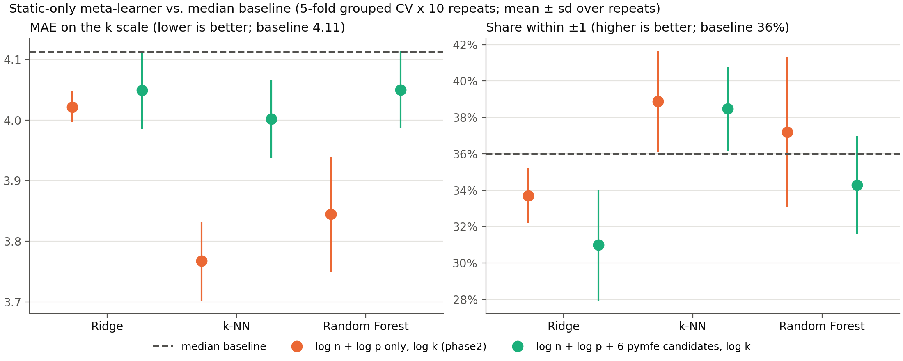
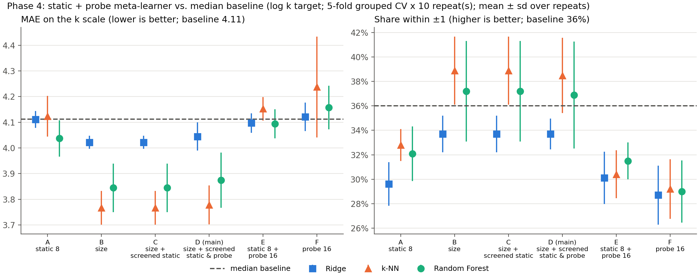
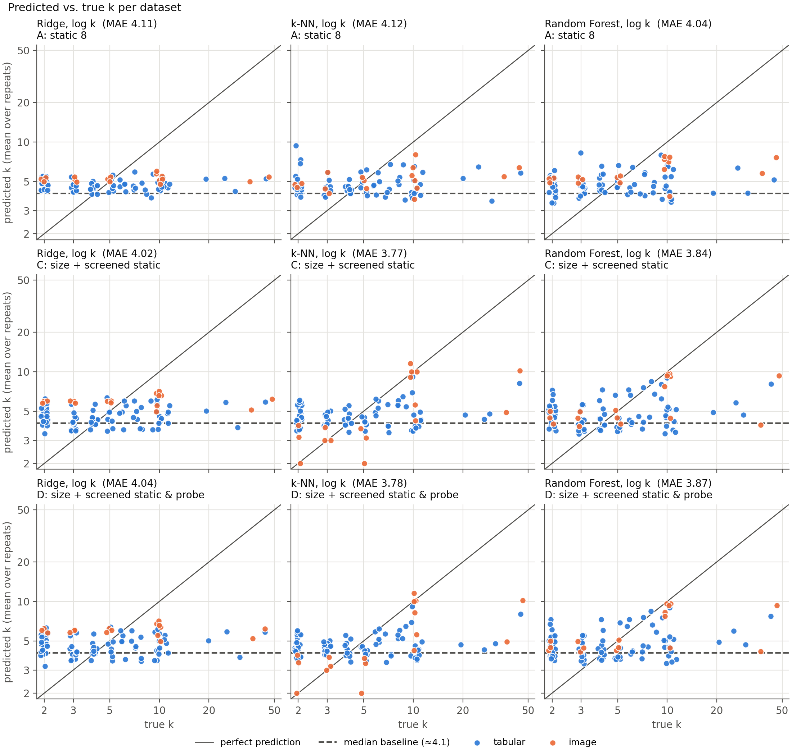
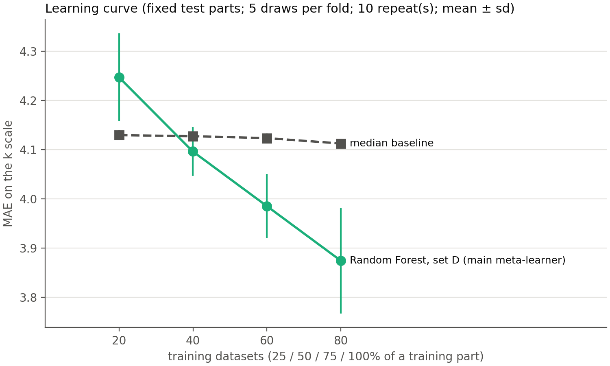
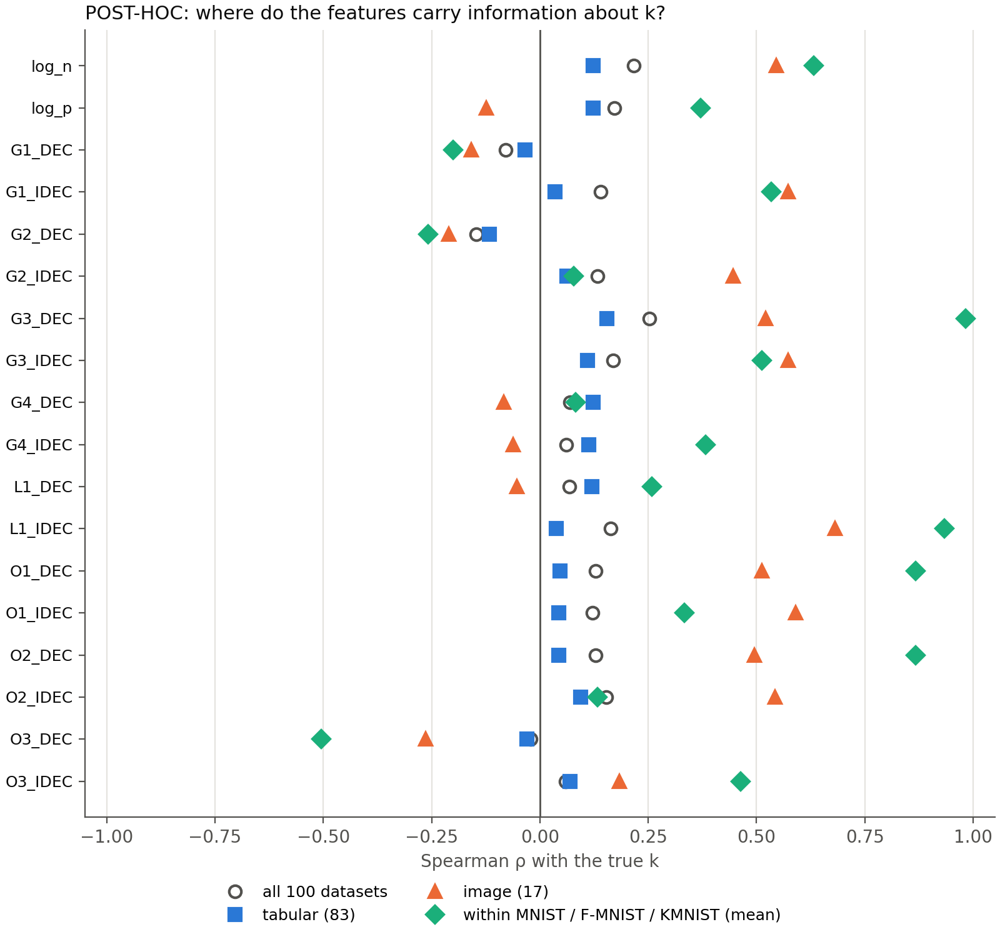

# Meta-learner methodology

Detailed methodology of the meta-learner that estimates the number of clusters *k*.
This file is the detailed record; the project docs only reference it
(decisions: *Design Decisions Log* D11; thesis reasoning: *Thesis Writing Notes* M10).

> **Current status (last updated 2026-10-01)**
> - Evaluation protocol: **frozen** on `master` (Section 2).
> - Phase 2, static-only baseline: **completed** on `master` (Section 5).
> - Static and classical meta-feature routes: **closed** (Section 10; branch `feature/proposed-metafeatures`, merged into `master`).
> - Phase 3, DEC/IDEC probe runs: **completed** (2026-09-27 – 2026-09-30, branch `feature/phase3-probes`, merged
>   into `master`). The pilot decided O2: overcomplete K + full T1 grid (Section 11.4). Full run: 100/100 datasets
>   → `data/probe_features.csv` (16 probe features, no missing values).
> - Phase 4, static + probe meta-learner: **main run, T3 measures and learning curve completed** (2026-10-01, branch
>   `feature/phase4-evaluation`, Section 12; design fixed before any result, Sections 12.1–12.9). Results (Sections
>   12.10–12.12): the probe features do not improve the meta-learner, the main meta-learner is not significantly
>   better than the median baseline, and by the §6 rule more datasets would not fix this. Post-hoc analysis (a)+(b)
>   done (Section 12.13): the probe features carry information about k on the image datasets but not on the tabular
>   ones. Next: decision on (c) and on changes to the setup (separate branch).
> - Learning curve (O1): **done** for the Phase 4 main meta-learner (Section 12.12).
>
> The [History](#history) table is the authoritative record of what has been done.
> Every development step adds a dated row there and updates this box.

| | |
|---|---|
| Code | `evaluation.py` (frozen protocol), `train_static.py` (Phase 2 runner); Phase 3: `probes.py`, `run_probes.py`, `analyze_pilot.py`, `build_probe_features.py`, `slurm/`; Phase 4: `train_phase4.py`, `learning_curve.py`, `t3_measures.py` |
| Results | `results/phase2/` (committed), full outputs in `outputs/phase2/` (git-ignored); Phase 3: `results/phase3_pilot/`, `results/phase3_full/`, `data/probe_features.csv` (committed), raw probe outputs on the cluster in `outputs/phase3/` (git-ignored); Phase 4: `results/phase4/`, `results/phase4_t3/`, `results/phase4_lc/` (committed), predictions in `outputs/phase4/` (git-ignored) |
| Quotes | only verified quotes are used; location and verification status in [Section 9](#9-references-and-quote-verification) |

## History

| date | branch | step | documented in |
|---|---|---|---|
| 2026-09-24 | `master` | Evaluation protocol frozen: `evaluation.py`, `data/cv_folds.csv` | Section 2 |
| 2026-09-24 | `master` | Phase 2 static-only run (13 configurations), results in `results/phase2/` | Section 5 |
| 2026-09-24 | `master` | Decision: 8 static meta-features do not beat the baseline; continue with structure-based meta-features on a separate branch | Section 7 |
| 2026-09-24 | `master` | Exploration scripts added: `experiments/phase2_exploration/` | Appendix A |
| 2026-09-24 | `master` | File fingerprints made independent of line endings (`train_static.py`); D11 and M10 added to the project docs | Section 8 |
| 2026-09-24 | `feature/proposed-metafeatures` | Branch created. Candidate meta-features: label-free pymfe features (eigenvalue spectrum, `t3`/`t4`, `wg_dist`, `cohesiveness`, `nr_norm`, `nr_cor_attr`, `sparsity`, itemsets); classical k-estimators parked as idea T1 (project doc *Ideas – To Be Tested*) | – |
| 2026-09-24 | `feature/proposed-metafeatures` | Screening on artificial data (sandbox): the controlled test is too lenient (the Phase 2 feature `cor_mean` passes), the heterogeneous test too strict (even silhouette fails) → decision moved to the real pool; §7 corrected (KMNIST) | Section 10.1 |
| 2026-09-24 | `feature/proposed-metafeatures` | Pool screening (`experiments/pymfe_screen/screen_pool.py`): none of the 6 candidates passes (all \|ρ beyond size\| ≤ 0.14). `train_static.py` extended (extra feature tables, feature sets, own output folder, fold-by-fold comparison with a reference run; default behaviour unchanged, verified). Branch renamed from `feature/structure-metafeatures` | Section 10.1 |
| 2026-09-24 | `feature/proposed-metafeatures` | Regressor confirmation (`results/pymfe_regressors/`): size + pymfe candidates worse than size only for all three models (+0.03 to +0.24 MAE, p-values ≥ 0.10) → candidates excluded. Stage 1–2 scripts added (`experiments/pymfe_screen/`) | Section 10.1 |
| 2026-09-25 | `feature/proposed-metafeatures` | T1 screening (`experiments/t1_classical/screen_t1.py`, results in `results/t1_classical/`): no classical estimator passes as meta-feature (all \|ρ beyond size\| ≤ 0.18); used directly, all are worse than the constant median (MAE 7.8–32.8 vs. 4.1) → T1 excluded; next Phase 3 | Section 10.2 |
| 2026-09-27 | `feature/phase3-probes` | Branch created from `master`. Phase 3 environment: torch 2.13.0+cu126 / torchvision 0.28.0+cu126 and clustpy 0.0.2 on the local PC and the cluster, one install command for both (`requirements-torch.txt`, `requirements.txt`, `env/constraints.txt`); local env snapshots moved to `env/`; `check_env.py`, `slurm/install_env.sh`, `slurm/check_env.sh`, `.gitattributes` added. Cluster node: glibc 2.39, gcc 13.2.0, Python 3.11.16 (GPU check pending) | Section 11.1 |
| 2026-09-27 | `feature/phase3-probes` | O2 pilot designed before any probe run: own probe loop around clustpy's DEC/IDEC parts; 12 pilot datasets; preprocessing, network, training budget, seeds, k-grid and overcomplete protocols; measurements M1–M12; candidate meta-features G1–G4, L1, O1–O3; decision rules R1–R3 | Sections 11.2–11.3 |
| 2026-09-27 | `feature/phase3-probes` | Probe code committed before any run: `probes.py` (self-test: pretraining, DEC and IDEC identical to clustpy's own fit functions), `run_probes.py` (resume, settings guard), `analyze_pilot.py` (candidates and R1–R3; tie rule smaller k, G3 missing if no k fully used, R1 time model a + b·p), `slurm/download_pilot.sh`, `slurm/run_pilot.sh`. GPU checks: RTX 2080 Ti and GTX 1080 Ti OK; `check_env.py` accepts code of the same GPU generation. §11.2 corrected (target-distribution note); G4 literature added (Q16–Q19) | Sections 9, 11.1–11.3 |
| 2026-09-28 | `feature/phase3-probes` | Pilot GPU changed from RTX 2080 Ti to RTX 2080 before any pilot run (no RTX 2080 Ti available); `slurm/run_pilot.sh` and R1 timing check in `analyze_pilot.py` adjusted | Section 11.3 |
| 2026-09-28 | `feature/phase3-probes` | Pilot run (12 datasets, 3 seeds, RTX 2080; GPU self-test identical to clustpy) and analysis with the committed `analyze_pilot.py`: R1 full grid passes (0.65 h extra on 6 GPUs), 9 of 16 features pass R2a → full run: overcomplete + full T1 grid, 3 seeds (O2 decided). Results in `results/phase3_pilot/` | Section 11.4 |
| 2026-09-29 | `feature/phase3-probes` | Full run on all 100 datasets started: `slurm/run_full.sh` (any free GPU, pilot datasets rerun); sequential download (`slurm/download_pool.sh`) timed out after 33 of 91 datasets (slow OpenML server, one aborted connection) → parallel download `slurm/download_pool_array.sh` | Section 11.4 |
| 2026-09-30 | `feature/phase3-probes` | Full run finished: 100/100 datasets. 42 array tasks (pool rows 56, 58–86, 88–99) had stopped immediately without output on worker-minor-1/-3 (node problem); resubmitted unchanged, all completed. `build_probe_features.py` → `data/probe_features.csv` (name + 16 features, no missing values, no true k); run summary in `results/phase3_full/`. Phase 3 completed; branch merged into `master` | Section 11.4 |
| 2026-10-01 | `feature/phase4-evaluation` | Branch created from `master`. Phase 4 design fixed before any result: screening of the 6 static + 16 probe candidates inside each training part with the §10.1 rule (deviation from §11.3: not on all 100 datasets); six feature sets × Ridge/k-NN/RF, log k only; RF primary; Holm-corrected decision rules for Q1 (2 tests) and Q2 (4 tests); baselines incl. direct probe and T1 estimators; learning curve for the main meta-learner; quotes Q20–Q21 (Ambroise & McLachlan 2002) added | Section 12 |
| 2026-10-01 | `feature/phase4-evaluation` | `train_phase4.py` added (design of §12). Smoke test in the Claude sandbox with random fake probe features, 1 repeat: sets A/B and the median baseline reproduce the Phase 2 fold scores (max difference 9e-16); the copied screening rule reproduces §10.1 (max 5e-5, rounding). Guard added before any result: a constant candidate fails the screening | Section 12.2 |
| 2026-10-01 | `feature/phase4-evaluation` | Main Phase 4 run on the user's PC (29.7 min; Phase 2 check passed, max difference 8.9e-16). Probe candidates passed the in-fold screening in 3 of 50 training parts; H1a/H1b not significant (no probe effect); RF D (MAE 3.87) not significantly better than the median (4.11) or the size-only k-NN (3.77), significantly better than the best direct probe (5.30) and classical (9.09) estimators, which are both worse than the median. Results in `results/phase4/` | Section 12.10 |
| 2026-10-01 | `feature/phase4-evaluation` | `learning_curve.py` (§12.8) and `t3_measures.py` (§12.7) added; details fixed before any of their results (bullets in §12.7–12.8; RRMSE and a tabular/image split added to T3). Smoke tests in the Claude sandbox with random fake probe features passed: the learning curve's 100% point reproduces the (fake) main run (max difference 9e-16); T3 reproduces the main-run MAE | Sections 12.7–12.8 |
| 2026-10-01 | `feature/phase4-evaluation` | T3 measures (`results/phase4_t3/`; MAE check passed): the MAE ranking holds for all measures; no model beats the training mean on MRAE, best RRMSE 0.985; the constant baselines win on MAPE and exact hits; on the image datasets the models beat the constants mainly through size (Spearman ρ 0.73, probes alone 0.34), on the tabular datasets no model ranks k | Section 12.11 |
| 2026-10-01 | `feature/phase4-evaluation` | Learning curve (57.8 min; 100% check passed): RF D 4.25 / 4.10 / 3.99 / 3.87 at ≈ 20/40/60/80 training datasets; step 75→100% −0.11 (2.8%, p = 0.31) → leveled off by the §6 rule; the model does not beat the median → "the features lack signal" (§6); descriptively the curve still falls | Section 12.12 |
| 2026-10-01 | `feature/phase4-evaluation` | Post-hoc analysis (a)+(b) designed after the Phase 4 results (labelled post-hoc, descriptive only): `posthoc_probes.py` added; smoke test with fake probe data passed | Section 12.13 |
| 2026-10-01 | `feature/phase4-evaluation` | Post-hoc analysis (a)+(b) run (labelled post-hoc, `results/phase4_posthoc/`): no probe feature carries information about k on the 83 tabular datasets (\|ρ\| ≤ 0.15, beyond size ≤ 0.21); on the 17 image datasets several do (ρ 0.45–0.68, also beyond size), and within MNIST / Fashion-MNIST / KMNIST G3_DEC orders k almost perfectly; G1 and L1_DEC are dominated by seed noise | Section 12.13 |
| 2026-10-02 | `feature/phase4-evaluation` | Post-hoc (c) designed (labelled post-hoc; uses the labels for diagnosis only): `posthoc_cluster_agreement.py` + `slurm/run_posthoc_c.sh`, reading rule fixed before the run; smoke test with synthetic data and the real row-draw code passed | Section 12.13 |

**Contents**
0. [Purpose and scope](#0-purpose-and-scope)
1. [Inputs](#1-inputs)
2. [Evaluation protocol (frozen)](#2-evaluation-protocol-frozen)
3. [Transforms](#3-transforms)
4. [Models compared](#4-models-compared)
5. [Results](#5-results)
6. [Learning curve (O1) – postponed](#6-learning-curve-o1--postponed)
7. [Conclusion of Phase 2 and consequences](#7-conclusion-of-phase-2-and-consequences)
8. [Reproducibility](#8-reproducibility)
9. [References and quote verification](#9-references-and-quote-verification)
10. [New, proposed meta-features](#10-new-proposed-meta-features-branch-featureproposed-metafeatures)
11. [Phase 3 – DEC/IDEC probe runs](#11-phase-3--decidec-probe-runs-branch-featurephase3-probes)
12. [Phase 4 – static + probe meta-learner](#12-phase-4--static--probe-meta-learner-branch-featurephase4-evaluation)
- [Appendix A – Exploratory analyses before the protocol was frozen](#appendix-a--exploratory-analyses-before-the-protocol-was-frozen)

---

## 0. Purpose and scope

The meta-learner is a **regressor** (supervisor requirement) that maps meta-features of a
dataset to an estimate of *k*, the number of classes present in the dataset (D4).

- **Phase 2 (this document, Sections 1–7):** a *static-only* meta-learner, trained only on
  the 8 static meta-features from Phase 1 (O3). It is the reference against which Phase 4
  (static + probe features from short DEC/IDEC runs) will be compared.
- Because Phase 4 must be compared on exactly the same footing, the **evaluation protocol
  (Section 2) is frozen** in `evaluation.py` and `data/cv_folds.csv` and is reused unchanged.

---

## 1. Inputs

- **Table:** `data/metafeatures.csv`, the frozen Phase 1 output (D10): 100 datasets
  (83 tabular, 8 image originals, 9 image class-subset variants), 0 missing values in the
  model columns.
- **Model input (exactly 8 columns, O3):** `log_n`, `log_p`, `skew_mean`, `skew_sd`,
  `kurt_min`, `kurt_q3`, `cor_mean`, `conc_mean`.
- **Target:** `k_true` (number of classes present, D4). Range 2–46, median 4.
- **Never model input (bookkeeping):** `dataset_id`, `name`, `source`, `group`, `classes`,
  `n`, `p_raw`, `p_used`, `runtime_s`. `evaluation.load_metafeatures()` checks that no
  feature column is also a bookkeeping or target column.
- **Row key:** `name` (unique); `dataset_id` is not unique because the image variants
  share the id of their source.
- **Groups:** `group`, 91 groups: 88 single datasets and 3 image sources with 4 rows each
  (MNIST, Fashion-MNIST, Kuzushiji-MNIST with k = 2, 3, 5, 10).
- Pool composition, filters and known limitations: Thesis Writing Notes M4 (not repeated here).

Distribution of the target in the pool:

| k | 2 | 3 | 4–5 | 6–9 | 10–19 | 20–50 |
|---|---|---|---|---|---|---|
| datasets | 26 | 15 | 21 | 14 | 18 | 6 |

The six datasets with k ≥ 20 (leaf 30, micro-mass 20, GTSRB-HueHist 43, isolet 26,
binary_alpha_digits 36, Devnagari-Script 46) cause 43% of the total absolute error of
the median baseline (177 of 410). This matters for how MAE is read (Section 2.6).

---

## 2. Evaluation protocol (frozen)

All settings below are implemented in `evaluation.py`. Decided with the user on
2026-09-24 (protocol decisions P1–P8); the evidence behind each choice comes from the
exploratory runs in Appendix A.

### 2.1 Unit of evaluation: the dataset

Each dataset is one meta-level example; cross-validation splits the *datasets* into folds.
Brazdil et al. describe exactly this meta-level setting: *"The multiple pass evaluation
with cross-validation requires that the base-level datasets are considered as instances."*
(Brazdil et al. 2022, p. 45, §3.4.2) [Q1]

### 2.2 Splitter (P1): stratified grouped 5-fold cross-validation

`StratifiedGroupKFold(n_splits=5, shuffle=True, random_state=r)` from scikit-learn 1.9.0.

- **Grouped** on `group`: all variants of one image source land in the same fold. Otherwise
  a near-copy of a test dataset (e.g. MNIST with k = 3 while testing MNIST with k = 5)
  would be in the training data. Brazdil et al. name this as a source of bias: *"it is
  important to ensure that the dataset used for evaluation is not included in the
  meta-dataset accompanying the metalearning system, as this would lead to a biased
  estimate of performance."* (p. 45, §3.4.1, "Avoiding biased evaluation") [Q2]
- **Stratified** on six k-bins: 2 | 3 | 4–5 | 6–9 | 10–19 | 20–50. These are the pool
  brackets of D10, except that k ≥ 20 is a separate bin, so that each test fold contains
  1–2 of the six datasets with very large k.
- Why stratified (Appendix A.1): with plain grouped splitting a test fold contained between
  1 and 9 datasets with k = 2 and between 0 and 4 with k ≥ 20; stratified with six bins it
  contains 5–6 and 1–2. The median baseline's repeat-to-repeat standard deviation dropped
  from 0.069 to 0.018. For the regressors (log k) the spread was similar under all
  splitters (≈ 0.10–0.13), so stratification makes folds comparable but does not change results.
- Resulting folds (`python evaluation.py --make-folds`): test parts of 19–21 datasets;
  per test part k2 5–6, k3 3, k4–5 4–5, k6–9 2–3, k10–19 3–4, k20–50 1–2 datasets.

### 2.3 Folds and repeats (P2): 5 folds × 10 repeats, seeds 0–9

- Each fit trains on ~80 and tests on ~20 datasets; the full split is repeated 10 times with
  `random_state = 0 … 9` (50 train/test pairs).
- Why (Appendix A.2): the scheme barely changes the mean (all within ≈ 0.05 MAE), but
  5 × 10 gave the most stable estimate (repeat-mean sd 0.092 for k-NN vs. 0.126 for
  10-fold and 0.132 for 3-fold); 20 repeats added nothing. 10-fold would leave only
  ~10 datasets per test part.

### 2.4 Frozen fold file (P3)

The split is created once and saved to `data/cv_folds.csv` (columns `name, group, repeat,
fold`), committed to git. Every later run reads this file instead of re-creating the split,
so it cannot change silently (e.g. after a library update or a reordered table).
`evaluation.check_folds()` verifies on every load that each dataset is tested exactly once
per repeat and that no group is split across folds. Brazdil et al.: *"When comparing the
performance of various metalearning/AutoML systems, this division should be constant in all
comparisons."* (p. 43, §3.4.1, para 1) [Q3]

### 2.5 Hyperparameter tuning: nested cross-validation (P4)

Hyperparameters are chosen **inside** each training part with `GridSearchCV` and an inner
`GroupKFold(5)` (groups kept together), scored with exactly the protocol's MAE. The test
part is never used for any choice. Brazdil et al.: *"As these systems do not (and must not)
use the test set in any way, an additional set of cases is required (Varma and Simon,
2006)."* (p. 44, §3.4.1) [Q4]; *"Note that the internal division can also be upgraded to
include a cross-validation procedure in the inner evaluation concerned with selection."*
(p. 44) [Q5]. The cited study concludes: *"Using CV to compute an error estimate for a
classifier that has itself been tuned using CV gives a significantly biased estimate of the
true error."* (Varma & Simon 2006, Abstract, Conclusion) [Q6]. Cawley & Talbot (2010) show
that *"some common performance evaluation practices are susceptible to a form of selection
bias as a result of this form of over-fitting and hence are unreliable."* (Abstract) [Q7]

Grids (`train_static.py`; widened after the exploration, where chosen values sat at the
grid edges):

| model | grid |
|---|---|
| Ridge | `alpha` ∈ 10^-3 … 10^5 (17 values, log-spaced) |
| k-NN | `n_neighbors` ∈ {1, 3, 5, 7, 10, 15, 20, 30} × `weights` ∈ {uniform, distance} |
| Random Forest (300 trees, `random_state=0`) | `min_samples_leaf` ∈ {1, 2, 5, 10, 20} × `max_features` ∈ {0.33, 0.5, 1.0} |

### 2.6 Metrics (P5)

For a test part with true values *k_i* and predictions *k̂_i*:

- Predictions are clipped at 2: *k̃_i* = max(*k̂_i*, 2) (there is no k < 2 in the pool).
- **MAE** (primary) on the original k scale, on the continuous clipped prediction:
  MAE = (1/m) Σ |*k_i* − *k̃_i*|.
- **Within ±1** (secondary): share of datasets with |round(*k̃_i*) − *k_i*| ≤ 1.
- **Aggregation:** the 5 folds of a repeat are averaged; reported is the mean ± sd over the
  10 repeat averages (the sd over single folds would mainly reflect which datasets happen to
  be in a fold).
- **Breakdown** (secondary, not used for decisions): MAE and within ±1 per k-bin and for
  tabular vs. image, pooled over all repeats.
- Notes for reading the numbers: (1) MAE is dominated by the k ≥ 20 tail (Section 1).
  (2) Within ±1 is lenient for small k (k = 2: 1–3 counts as a hit) and strict for large k.
  (3) Clipping at 2 was practically irrelevant (0–0.4% of predictions below 2), and MAE on
  rounded vs. continuous predictions differed by ≤ 0.01 (Appendix A.3).

**Baseline:** a model that always predicts the median k **of the training part** (recomputed
in every fold). For MAE, the median is the best possible constant prediction, so this
baseline is deliberately hard to beat.

### 2.7 Statistical comparison (P6): corrected resampled t-test

Two configurations are compared on the identical 50 train/test pairs. For the per-pair
differences *d_j* = MAE_A,j − MAE_B,j (j = 1 … J, J = 50):

t = d̄ / √[(1/J + n_test/n_train) · s_d²], with J − 1 degrees of freedom,

where s_d² is the sample variance of the *d_j* and n_test/n_train ≈ 20/80. The correction
factor accounts for the overlap between training parts; it is the corrected resampled
t-test of Nadeau & Bengio (2003) as applied to repeated k-fold CV by Bouckaert & Frank (2004)
(references in Section 9; **not verified yet**). Reported with the mean difference and its
corrected 95% interval.

Why (Appendix A.5): in 300 simulated pools in which two models were *exactly* equally good,
a plain paired t-test declared a significant difference in 51% of pools (nominal 5%); the
corrected test did so in 1%. The corrected test is therefore safe but conservative: with
our data an MAE improvement must be about **0.32** (≈ 8%) to be detectable.

### 2.8 Rule for Phase 4 (P7)

If probe runs fail on some datasets, both static-only and static+probe are re-evaluated on
the same remaining datasets, with their folds taken from `data/cv_folds.csv`
(`evaluation.check_folds` accepts a subset and `iter_splits` skips missing rows).

---

## 3. Transforms

### 3.1 Signed log for skewness and kurtosis columns

`skew_mean`, `skew_sd`, `kurt_min`, `kurt_q3` are transformed with
**sign(x) · log(1 + |x|)**. Reason: very uneven ranges and negative values (M9):

| column | min | median | max | negative values |
|---|---|---|---|---|
| `skew_mean` | −1.22 | 2.00 | 91.3 | 10 |
| `skew_sd` | 0.04 | 2.46 | 88.6 | 0 |
| `kurt_min` | −2.00 | −1.22 | 45.6 | 86 |
| `kurt_q3` | −1.59 | 6.86 | 34,775 | 19 |

A plain log is undefined for negative values; the signed log keeps the sign, is 0 at 0 and
compresses large values. It has no fitted parameters, so it cannot leak information from the
test part. It is applied for all three models: Ridge and k-NN need it (otherwise
`kurt_q3` dominates coefficients and distances); Random Forest is unaffected by monotone
transforms, so one shared preprocessing is simplest. `log_n`, `log_p` are already on a log
scale; `cor_mean`, `conc_mean` lie in [0, 1] and are left unchanged.

### 3.2 Scaling

Ridge and k-NN: `StandardScaler`, fitted on the training part only (inside the pipeline).
Random Forest: no scaling (trees compare values within a column only).

### 3.3 Target: raw k vs. log k

Every regressor is trained twice: on k directly, and on log(k) with the prediction
converted back by exp (`TransformedTargetRegressor`). All metrics and the tuning score
stay on the k scale. With log k, errors count by factor (predicting 4 for k = 2 weighs
the same as predicting 20 for k = 10), so the few large-k datasets no longer dominate
training.

---

## 4. Models compared

13 configurations, all on the identical folds:

| configuration | inputs | target |
|---|---|---|
| **median baseline** | none | – |
| Ridge, k-NN, Random Forest | 8 static meta-features | raw k / log k |
| Ridge, k-NN, Random Forest | `log_n` + `log_p` only | raw k / log k |

- **Ridge:** linear model with L2 penalty; the simplest model that uses all features.
- **k-NN:** predicts from the most similar datasets in meta-feature space; the classic
  meta-learning approach of recommending from similar past datasets.
- **Random Forest:** non-linear, robust to irrelevant features; standard in meta-learning.
- **Size-only inputs (`log_n` + `log_p`):** the "heuristics based on dataset
  size/dimension" baseline listed in the supervisor's thesis proposal [Q8].
  *Disclosure:* this configuration was added after the exploratory runs (Appendix A.6)
  had shown that removing the six distribution features helped; it is therefore not an
  a-priori hypothesis, and its result is interpreted with that in mind (Section 5.2, finding 3).

---

## 5. Results

Full run on the user's PC, 2026-09-24 (14.7 min; versions and fingerprints in Section 8).
Source: `results/phase2/summary.csv`, `breakdown.csv`, `hyperparameters.csv`.

### 5.1 Main table

Mean ± sd over 10 repeats. Δ = MAE(model) − MAE(baseline); negative = better than the
baseline; 95% interval and p from the corrected t-test (Section 2.7).

| configuration | MAE | within ±1 | Δ MAE [95% interval] | p |
|---|---|---|---|---|
| **median baseline** | **4.112 ± 0.010** | **36.0%** | – | – |
| Ridge, 8 features, raw k | 4.598 ± 0.057 | 16.2% | +0.485 [+0.208, +0.763] | 0.001 |
| Ridge, 8 features, log k | 4.111 ± 0.033 | 29.6% | −0.001 [−0.102, +0.099] | 0.979 |
| k-NN, 8 features, raw k | 4.539 ± 0.068 | 20.4% | +0.427 [+0.064, +0.790] | 0.022 |
| k-NN, 8 features, log k | 4.123 ± 0.079 | 32.8% | +0.011 [−0.214, +0.236] | 0.925 |
| RF, 8 features, raw k | 4.640 ± 0.120 | 15.6% | +0.528 [+0.191, +0.864] | 0.003 |
| RF, 8 features, log k | 4.037 ± 0.071 | 32.1% | −0.075 [−0.243, +0.092] | 0.371 |
| Ridge, size only, raw k | 4.451 ± 0.024 | 20.2% | +0.338 [+0.032, +0.645] | 0.031 |
| Ridge, size only, log k | 4.022 ± 0.026 | 33.7% | −0.091 [−0.233, +0.052] | 0.207 |
| k-NN, size only, raw k | 4.186 ± 0.136 | 26.5% | +0.074 [−0.430, +0.578] | 0.769 |
| **k-NN, size only, log k** | **3.767 ± 0.066** | **38.9%** | **−0.345 [−0.630, −0.061]** | **0.018** |
| RF, size only, raw k | 4.473 ± 0.159 | 26.2% | +0.361 [−0.118, +0.840] | 0.136 |
| RF, size only, log k | 3.844 ± 0.095 | 37.2% | −0.268 [−0.580, +0.044] | 0.090 |





### 5.2 Findings

1. **Raw k hurts.** All six raw-k configurations are worse than the baseline, four of them
   significantly (p ≤ 0.031). Trained on raw k, the models are pulled towards the large-k
   datasets and over-predict small k (k = 2, 3 predicted as ≈ 5–8, top row of the
   predicted-vs-true figure).
2. **The 8 static meta-features do not beat the baseline.** With log k, the three models
   reach MAE 4.04–4.12 against 4.11 (all p ≥ 0.37) and fewer hits within ±1 (30–33% vs.
   36%). Tuning chose strong smoothing (Ridge `alpha` 100–316 in 44 of 50 folds; k-NN
   10–30 neighbours in 39 of 50), i.e. predictions close to a constant.
3. **Size only is slightly better, but mostly on image data.** k-NN on `log_n` + `log_p`
   with log k is the only configuration significantly better than the baseline
   (Δ = −0.345, p = 0.018); RF is similar but not significant (p = 0.09).
   - Of its total gain over the baseline, **87% comes from the 17 image datasets**
     (30.0 of 34.5 summed absolute error); on the 83 tabular datasets the gain is 0.05 per
     dataset. The model essentially learns "very large n and p → image source → k ≈ 10".
     This is partly a consequence of how the pool was built (large image originals with
     k = 10, small variants with k ≤ 5).
   - It is one of 12 comparisons against the baseline. With a Bonferroni correction
     (0.05 / 12 ≈ 0.004) it would not be significant. (The multiplicity correction was not
     part of the frozen protocol; it is reported as additional caution.)
   - Because the configuration was added after the exploration (Section 4), it is a
     post-hoc finding.
4. **Adding the six distribution features makes the size signal worse** (e.g. k-NN log k:
   3.77 size only vs. 4.12 with all 8), consistent with irrelevant features adding noise
   (Brazdil et al.: *"The improvement can be attributed to the fact that 'noisy' attributes
   have been dropped."*, p. 67 [Q9], said about feature selection at the meta level).
   On the tabular datasets, RF with all 8 features is even slightly worse than the baseline
   (+0.08 per dataset).

### 5.3 Where the errors are

MAE per k-bin and source (pooled over repeats), for the baseline, the best 8-feature
configuration and the best size-only configuration (all with log k where applicable):

| subgroup (datasets) | median baseline | RF, 8 features | k-NN, size only |
|---|---|---|---|
| k = 2 (26) | **2.06** | 2.76 | 2.44 |
| k = 3 (15) | **1.06** | 1.84 | 1.21 |
| k = 4–5 (21) | **0.52** | 0.81 | 0.94 |
| k = 6–9 (14) | 3.08 | 2.35 | **2.07** |
| k = 10–19 (18) | 6.16 | 4.80 | **4.59** |
| k = 20–50 (6) | 29.45 | 27.99 | **27.32** |
| tabular (83) | 3.49 | 3.57 | **3.43** |
| image (17) | 7.16 | 6.31 | **5.40** |

The models trade accuracy on small k (where the baseline, predicting ≈ 4, is already
close) for slightly smaller errors on larger k. None of them comes close to the k ≥ 20
datasets: predictions for these stay around 4–9 (e.g. Devnagari-Script, k = 46).

### 5.4 Known limitations of the pool (M4)

| dataset | k | median baseline | RF, 8 features, log k | k-NN, size only, log k |
|---|---|---|---|---|
| Speech (anomaly benchmark) | 2 | 4.1 | 4.6 | 4.6 |
| cnae-9 (2 of 9 classes) | 2 | 4.0 | 5.3 | 5.5 |
| gina_prior2 (MNIST-derived, own group) | 10 | 4.0 | 4.6 | 3.7 |

Mean predictions over repeats. The feared advantage of gina_prior2 from mnist_784 being in
the training data is not visible (predictions ≈ 4 instead of ≈ 10).

### 5.5 Consistency check

The results on the user's PC agree with the exploratory sandbox runs (Appendix A): the
same splits (identical fold file content, Section 8) and the same pattern (8 features ≈
baseline; size-only k-NN ≈ 3.77).

---

## 6. Learning curve (O1) – postponed

Decided 2026-09-24: the learning curve is run once the feature set is final, because it
asks whether more datasets would help *that* set. The design is fixed now so that it cannot
be adapted to the result:

- Test folds as in Section 2; only the training part is subsampled (by group, stratified by
  k-bin) to 25/50/75/100% (≈ 20/40/60/80 training datasets), 5 random draws per fraction.
  (In the exploration, a step of this design had a noise level of ≈ 0.02 MAE; subsampling
  the whole pool first was 15–20 times noisier, Appendix A.4.)
- **Plateau rule:** the curve has leveled off if the MAE improves by less than 5% from 75% to
  100% **and** the corrected t-test (Section 2.7) is not significant.
- **Additional condition:** a flat curve closes O1 as "100 datasets are enough" only if the
  model at 100% beats the median baseline. Otherwise the conclusion is "the features lack
  signal", which more datasets would not fix.

**Run (2026-10-01):** for the Phase 4 main meta-learner, see Section 12.12.

---

## 7. Conclusion of Phase 2 and consequences

**Result.** The 8 static meta-features do not allow the meta-learner to predict k better
than always guessing the median. The only improvement comes from dataset size, mainly by
recognizing the large image datasets.

**Why (interpretation).** The selected features describe single columns (skewness,
kurtosis) and pairwise dependence (correlation, concentration), not how many groups of
points exist. Controlled check with the Fashion-MNIST variants (same images, n = 5,000,
only k changes): none of the six distribution features moves with k.

| | k | skew_mean | skew_sd | kurt_min | kurt_q3 | cor_mean | conc_mean |
|---|---|---|---|---|---|---|---|
| Fashion-MNIST_k2 | 2 | 3.70 | 10.80 | −1.76 | 2.82 | 0.221 | 0.029 |
| Fashion-MNIST_k3 | 3 | 4.85 | 10.31 | −1.59 | 18.90 | 0.193 | 0.014 |
| Fashion-MNIST_k5 | 5 | 2.27 | 6.47 | −1.72 | 2.15 | 0.204 | 0.039 |
| Fashion-MNIST | 10 | 3.62 | 12.72 | −1.74 | 4.42 | 0.214 | 0.022 |

(Corrected 2026-09-24: in KMNIST, `cor_mean` does decrease with k at fixed n, 0.140 → 0.121 → 0.094
for k = 2, 3, 5; in MNIST the change is small. Across the pool such within-source changes are
swamped by the differences between datasets: `cor_mean` has ρ = −0.02 with k.) This fails Brazdil et al.'s first requirement for
meta-features: *"Discriminative power. The set of metafeatures should contain information
that distinguishes between the base-algorithms in terms of their performance."* (p. 53,
§4.1) [Q10]. A negative result of this kind has a precedent: for one of their targets,
Pimentel & de Carvalho report that *"the average and majority baselines presented the best
predictive performance for the MAPE, MRAE and RRMSE measures."* (2020, p. 6, §6.1.1) [Q11]
(their target is the k chosen by a validity index for k-means, not the class count; M1).

**Consequences (decided by the user, 2026-09-24).** *This is the plan as of 2026-09-24;
the [History](#history) table shows what has been done since.*
- The static-only result stands as the Phase 2 reference (on `master`).
- Next step, on a separate git branch: add meta-features that describe the *structure* of
  the point cloud (candidates to be fixed before testing), evaluated with this unchanged
  protocol. All tried feature sets are reported, not only the best one.
- For Phase 4: an improvement must be ≈ 0.32 MAE or larger to be detectable with the
  corrected test (Section 2.7).

---

## 8. Reproducibility

```
pip install -r requirements.txt           # conda env ai-meta-k, Python 3.11.15
python evaluation.py --make-folds         # once; creates data/cv_folds.csv (refuses to overwrite)
python evaluation.py --check              # optional: re-check the fold file
python train_static.py                    # full run, ~15 min on the user's PC
python train_static.py --repeats 1        # quick test run; does not touch results/
```

| item | value |
|---|---|
| Python / numpy / pandas / scipy / scikit-learn / matplotlib | 3.11.15 / 2.4.6 / 3.0.5 / 1.17.1 / 1.9.0 / 3.10.9 |
| seeds | splits: `random_state` = repeat (0–9); Random Forest: 0 |
| `metafeatures.csv` SHA-256 | `ab77ee3d…25e02fb` |
| `cv_folds.csv` SHA-256 | `6bc096af…868b2` in the Phase 2 `run_info.json` (Windows line endings, as written on the PC); `721afc6e…3c5b4f` for the identical content with Linux line endings |
| runtime (full run) | 879 s |
| fingerprint note | Since 2026-09-24 (after the Phase 2 run) `train_static.py` computes fingerprints with line endings normalized, so later runs report `721afc6e…` for the folds on every system. The Phase 2 `run_info.json` still shows the older, Windows-specific value. |

Output files (`results/phase2/`): `summary.csv` (one row per configuration incl. the
t-test against the baseline), `fold_scores.csv` (50 × 13 rows), `hyperparameters.csv`
(chosen values per fold), `breakdown.csv`, `fig_scores.png`, `fig_pred_vs_true.png`,
`run_info.json`. Per-dataset predictions are in `outputs/phase2/predictions.csv`
(git-ignored; regenerated deterministically by the run).

---

## 9. References and quote verification

Location format: paper / page / paragraph. "Verified" = the exact wording was checked in
the source text; the column says how.

| # | quote (short) | location | ends in citation? | verification |
|---|---|---|---|---|
| Q1 | "The multiple pass evaluation with cross-validation requires that the base-level datasets are considered as instances." | Brazdil et al. 2022 / p. 45 / §3.4.2, para 1 | no | verified in the project PDF (full text) |
| Q2 | "it is important to ensure that the dataset used for evaluation is not included in the meta-dataset …, as this would lead to a biased estimate of performance." | Brazdil et al. 2022 / p. 45 / §3.4.1, "Avoiding biased evaluation", para 1 | no | verified in the project PDF |
| Q3 | "When comparing the performance of various metalearning/AutoML systems, this division should be constant in all comparisons." | Brazdil et al. 2022 / p. 43 / §3.4.1, para 1 | no | verified in the project PDF |
| Q4 | "As these systems do not (and must not) use the test set in any way, an additional set of cases is required (Varma and Simon, 2006)." | Brazdil et al. 2022 / p. 44 / §3.4.1, "Inner evaluation carried out by metalearning/AutoML systems", para 2 | **yes** → Varma & Simon 2006; its meaning is confirmed by Q6 | verified in the project PDF |
| Q5 | "Note that the internal division can also be upgraded to include a cross-validation procedure in the inner evaluation concerned with selection." | Brazdil et al. 2022 / p. 44 / same subsection, para 4 | no | verified in the project PDF |
| Q6 | "Using CV to compute an error estimate for a classifier that has itself been tuned using CV gives a significantly biased estimate of the true error." | Varma & Simon 2006 / p. 1 / Abstract, Conclusion | no | confirmed in the PDF by the user, 2026-09-24 |
| Q7 | "some common performance evaluation practices are susceptible to a form of selection bias as a result of this form of over-fitting and hence are unreliable." | Cawley & Talbot 2010 / p. 2079 / Abstract | no | confirmed in the PDF by the user, 2026-09-24 |
| Q8 | "Compare against simple baselines (e.g., fixed k, heuristics based on dataset size/dimension, or classical internal metrics if desired)" | Aljoud 2026, thesis proposal / p. 2 / §3 Tasks, last item | no | verified in the project PDF (supervisor's proposal, not peer-reviewed) |
| Q9 | "The improvement can be attributed to the fact that 'noisy' attributes have been dropped." | Brazdil et al. 2022 / p. 67 / §4.7.1, para 4 | no, but it explains the previous sentence, which cites Todorovski et al. 2000 and Kalousis & Hilario 2001a (not checked) | verified in the project PDF |
| Q10 | "Discriminative power. The set of metafeatures should contain information that distinguishes between the base-algorithms in terms of their performance." | Brazdil et al. 2022 / p. 53 / §4.1, "What are good dataset features?", 1st item | no | verified in the project PDF |
| Q11 | "the average and majority baselines presented the best predictive performance for the MAPE, MRAE and RRMSE measures." | Pimentel & de Carvalho 2020 / p. 6 / §6.1.1 "Elbow technique", para 2 (bottom of left column, continues in right column) | no | verified in the project PDF (page image) |
| Q12 | "Determining hyperparameters by cross-validation on a validation set is not an option in unsupervised clustering. Thus we use commonly used parameters for DNNs and avoid dataset specific tuning as much as possible." | Xie et al. 2016 / p. ? (to add) / §4.3, para 1 | no | wording confirmed by the user in the PDF, 2026-09-27; page to add |
| Q13 | "Specifically, inspired by van der Maaten (2009), we set network dimensions to d–500–500–2000–10 for all datasets, where d is the data-space dimension, which varies between datasets." | Xie et al. 2016 / p. ? (to add) / §4.3, para 1 | refers to van der Maaten 2009 (not checked) | wording confirmed by the user in the PDF, 2026-09-27; page to add |
| Q14 | "(2) generalizability (G) which is defined as the ratio between training and validation loss: G = Ltrain/Lvalidation." | Xie et al. 2016 / p. ? (to add) / §5.5, para 1 | no | wording confirmed by the user in the PDF, 2026-09-27; page to add |
| Q15 | "Fig. 6 shows a sharp drop in generalizability when cluster number increases from 9 to 10, which suggests that 9 is the optimal number of clusters." | Xie et al. 2016 / p. ? (to add) / §5.5, para 1 | no | wording confirmed by the user in the PDF, 2026-09-27; page to add |
| Q16 | "The method can be used with any clustering algorithm; it provides a means of rationally defining an optimum number of clusters, and can also detect the lack of structure in data." | Ben-Hur et al. 2002 / p. 6 / Abstract | no | wording confirmed by the user in the PDF, 2026-09-27 |
| Q17 | "Thus it is reasonable to postulate that a partition into k clusters has captured the 'inherent' structure in a dataset if partitions into k clusters obtained from running the clustering algorithm with different subsamples are similar …" | Ben-Hur et al. 2002 / p. 7 / §3, para 1 | no | wording confirmed by the user in the PDF, 2026-09-27 |
| Q18 | "These examples indicate a simple way for identifying k; choose the value where there is a transition from a score distribution that is concentrated near 1 to a wider distribution." | Ben-Hur et al. 2002 / p. 10 / §4, last para | no | wording confirmed by the user in the PDF, 2026-09-27 |
| Q19 | "In particular we conclude that stability is not a well-suited tool to determine the number of clusters – it is determined by the symmetries of the data which may be unrelated to clustering parameters." | Ben-David et al. 2006 / first page / Abstract | no | wording confirmed by the user in the PDF, 2026-09-27 |
| Q20 | "Thus the test set must play no role in the feature-selection process for an unbiased estimate to be obtained." | Ambroise & McLachlan 2002 / p. 6566 / Discussion, left column | no | wording identical in two copies (PMC full text, PDF); confirmed by the user in the PDF, 2026-10-01 |
| Q21 | "In the present context where feature selection is used in training the prediction rule R from the full training set, the same feature-selection method must be implemented in training the rule on the M − 1 subsets combined at each stage of an (external) cross-validation of R for the selected subset of genes." | Ambroise & McLachlan 2002 / p. 6563 / "Cross-Validation", left column | no | same as Q20 |

**NOT VERIFIED** (as of 2026-09-24): cited without a quote; content and details still to be checked in the papers:
- Nadeau, C., Bengio, Y. (2003). Inference for the generalization error. *Machine Learning*
  52, 239–281. https://doi.org/10.1023/A:1024068626366
- Bouckaert, R. R., Frank, E. (2004). Evaluating the replicability of significance tests
  for comparing learning algorithms. *PAKDD 2004*, LNCS 3056, 3–12 (link to be added after checking).
- Holm, S. (1979). A simple sequentially rejective multiple test procedure. *Scandinavian Journal of
  Statistics* 6(2), 65–70. https://www.jstor.org/stable/4615733 (added 2026-10-01)

References:
- Brazdil, P., van Rijn, J. N., Soares, C., Vanschoren, J. (2022). *Metalearning:
  Applications to Automated Machine Learning and Data Mining*, 2nd ed. Springer.
  https://doi.org/10.1007/978-3-030-67024-5
- Cawley, G. C., Talbot, N. L. C. (2010). On over-fitting in model selection and subsequent
  selection bias in performance evaluation. *JMLR* 11, 2079–2107.
  https://jmlr.org/papers/v11/cawley10a.html
- Varma, S., Simon, R. (2006). Bias in error estimation when using cross-validation for model
  selection. *BMC Bioinformatics* 7, 91. https://doi.org/10.1186/1471-2105-7-91
- Pimentel, B. A., de Carvalho, A. C. P. L. F. (2020). A meta-learning approach for
  recommending the number of clusters for clustering algorithms. *Knowledge-Based Systems*
  195, 105682. https://doi.org/10.1016/j.knosys.2020.105682
- Aljoud, M. (2026). Bachelor Thesis Proposal: Meta-Learning the Number of Clusters for Deep
  Clustering. LMU Munich (unpublished).
- Xie, J., Girshick, R., Farhadi, A. (2016). Unsupervised deep embedding for clustering analysis. *ICML*, PMLR 48,
  478–487. https://proceedings.mlr.press/v48/xieb16.html
- van der Maaten, L. (2009). Learning a parametric embedding by preserving local structure. *AISTATS*, PMLR 5,
  384–391. https://proceedings.mlr.press/v5/maaten09a.html (not checked)
- NVIDIA. CUDA Compatibility – minor version compatibility.
  https://docs.nvidia.com/deploy/cuda-compatibility/minor-version-compatibility.html
- Leiber, C. et al. Benchmarking deep clustering algorithms with ClustPy, code repository
  https://github.com/collinleiber/BenchmarkingDeepClustering (`benchmark.py`; code, not paper text)
- Ben-Hur, A., Elisseeff, A., Guyon, I. (2002). A stability based method for discovering structure in
  clustered data. *Pacific Symposium on Biocomputing* 7, 6–17. https://doi.org/10.1142/9789812799623_0002
  (open PDF: https://psb.stanford.edu/psb-online/proceedings/psb02/benhur.pdf)
- Ben-David, S., von Luxburg, U., Pál, D. (2006). A sober look at clustering stability. *COLT 2006*, LNAI 4005.
  https://doi.org/10.1007/11776420_4
- Ambroise, C., McLachlan, G. J. (2002). Selection bias in gene extraction on the basis of microarray
  gene-expression data. *PNAS* 99(10), 6562–6566. https://doi.org/10.1073/pnas.102102699
  (free full text: https://pmc.ncbi.nlm.nih.gov/articles/PMC124442)

---

## 10. New, proposed meta-features (branch `feature/proposed-metafeatures`)

The static features of Phase 2 do not beat the median baseline (Section 7). This section
documents the search for meta-features that carry information about k. Every candidate set
is evaluated with the unchanged protocol (Section 2); the candidates and the decision rules
are fixed before each run, and all attempts are reported, including the failed ones.

### 10.1 Step 1 – label-free pymfe meta-features (2026-09-24): not viable

**Candidates.** The 38 meta-features of pymfe 0.4.4 that can be computed without labels
(D3), minus those already used or excluded in Phase 1 (M5–M8). References as listed in the
pymfe documentation (meta-feature description table); **not yet verified**:

| family | pymfe features (reference in the pymfe table) | reason to expect a link to k |
|---|---|---|
| A eigenvalue spectrum | `eigenvalues` (Ali & Smith 2006), on standardized data | k separated groups spread along ≈ k − 1 directions |
| B PCA dimension ratios | `t3`, `t4` (Lorena et al. 2019), on standardized data | same idea as A in one number |
| C density | `wg_dist`, `cohesiveness` (Vilalta 1999; Vilalta & Drissi 2002) | clumpiness of the points |
| D other | `nr_norm`, `nr_cor_attr`, `sparsity`, `one_itemset`, `two_itemset` | weak; included so their rejection is documented |

Excluded upfront: scale-dependent statistics (M6), `t2` = p/n (redundant with log n, log p),
`attr_ent` (M7), `nr_outliers` (M5), counts that are constant in the all-numeric pool.
The pymfe *clustering* group (silhouette, Calinski–Harabasz, …) is not in this step: pymfe
computes it on the true classes, which would leak k (D3). Its label-free use on k-means
partitions is the next step (T1, project doc *Ideas – To Be Tested*).

**Screening in three stages** (scripts in `experiments/pymfe_screen/`):

1. *Controlled artificial series* (`stage1_controlled.py`): Gaussian groups with k = 2–50
   (p ∈ {5, 20, 60}, two separations, n = 1,000) and class subsets of scikit-learn's digits
   (k = 2, 3, 5, 10 at fixed n = 340). Criterion |ρ| ≥ 0.5 with the same sign in both.
   Six candidates passed (e.g. effective dimension ρ = 0.96 / 0.82) – but so did the Phase 2
   feature `cor_mean` (ρ = −0.96 / −0.78), which has ρ = −0.02 on the real pool.
   → This stage is too lenient.
2. *Heterogeneous artificial datasets* (`stage2_heterogeneous.py`): 300 datasets, each with
   its own within-group correlations, noise columns, group sizes, separation, p and column
   scales. All candidates failed (|ρ| ≤ 0.31); `cor_mean` reached −0.03, close to its real
   value. Calibration (`stage2_calibration.py`): even "the k with the best silhouette" only
   reached ρ = 0.18. → This stage is too strict; only the real pool can decide.
3. *Real pool* (`screen_pool.py`): the six stage-1 survivors, computed on the 100 pool
   datasets with the same loading as `extractor.py`. Criterion, fixed before the run:
   |ρ beyond size| ≥ 0.30 on all datasets and ≥ 0.20 on the 83 tabular ones, same sign
   ("beyond size" = partial Spearman correlation after removing log n and log p).

| candidate | ρ beyond size (all 100) | ρ beyond size (tabular 83) | pass |
|---|---|---|---|
| A_eff_rank_ratio | −0.08 | −0.12 | no |
| A_top1_share | −0.03 | −0.04 | no |
| A_n90_ratio | −0.10 | −0.13 | no |
| B_t4 | −0.04 | −0.05 | no |
| C_wg_dist_mean | 0.14 | 0.13 | no |
| D_nr_cor_attr | −0.02 | −0.03 | no |
| *Phase 2 features (reference)* | *−0.14 … 0.05* | *−0.05 … 0.09* | – |

Source: `results/pymfe_screen/screen_result.csv` (candidate values: `candidates.csv`).

**Confirmation with the regressors.** A univariate screen cannot rule out that the features
help in combination or non-linearly, so the full protocol was run with log n + log p + the six
candidates (log k target; `train_static.py --name pymfe_regressors …`) and compared fold by
fold with the Phase 2 size-only models (same folds; corrected t-test). Decision rule, fixed
before the run: the candidates are excluded if no model is significantly better (p-value
< 0.05) than its size-only counterpart.

| model | MAE, size + pymfe | Δ vs. size only [95% interval] | p-value | Δ vs. median baseline (p-value) |
|---|---|---|---|---|
| Ridge | 4.049 ± 0.064 | +0.028 [−0.150, +0.205] | 0.76 | −0.063 (0.56) |
| k-NN | 4.002 ± 0.064 | +0.235 [−0.046, +0.515] | 0.10 | −0.111 (0.43) |
| Random Forest | 4.050 ± 0.064 | +0.206 [−0.096, +0.507] | 0.18 | −0.062 (0.66) |

Adding the candidates makes every model worse than size alone, and none beats the median
baseline. The median baseline of this run is identical, fold by fold, to Phase 2 (same splits).
Source: `results/pymfe_regressors/`.



**Interpretation.** On artificial data the eigenvalue features rise strongly with k; on the
real pool the sign even flips. How many dimensions carry the variance of a real dataset depends
on the kind of data (e.g. correlated neighbouring pixels in images) far more than on its number
of classes. Together with Phase 2: meta-features that describe single columns, pairs of columns
or the dimensionality carry no usable information about the class count in this pool.

**Disclosures.** (1) The candidates were screened on the same 100 datasets used for
evaluation; this would only matter for a candidate that passed. (2) Screening-only
subsampling: at most 20,000 rows for A, B, D and 1,000 rows for C (deviates from M9).
(3) `t4` was computed with pymfe's `MFEComplexity.ft_t4` directly: identical value, but the
complexity group would first build an all-pairs distance table (hours for e.g. dilbert).
(4) Stages 1–2 ran in the Claude sandbox; stage 3 and the regressor run ran on the user's PC.

**Decision (user, 2026-09-24):** the label-free pymfe meta-features are excluded. Next step:
T1, classical k-estimators (pymfe clustering group on k-means partitions), with "best single
classical estimator" as an additional baseline.

### 10.2 Step 2 – classical k-estimators on a fixed k grid (T1, 2026-09-25): not viable

**Idea.** Clustering methods that need k as input are run for every k of a fixed grid; a
validity index rates each partition, and "the k the index rates best" is (a) a candidate
meta-feature and (b) a classical estimator of k, i.e. a baseline. No labels are used.

**Settings (fixed before the run; `experiments/t1_classical/screen_t1.py`).** Grid k ∈ {2, 3, 4,
5, 6, 8, 10, 13, 16, 20, 25, 30, 40, 50} (from the pool filter 2–50, not from the true k);
grid values with k > n/5 skipped; ≤ 5,000 rows per dataset, standardized columns. k-means
(n_init = 3) rated by silhouette (on 2,000 rows), Calinski–Harabasz and Davies–Bouldin
(pymfe `MFEClustering.ft_sil/ft_ch/ft_vdb`); Gaussian mixture with diagonal covariances
rated by BIC. Same pass criterion as in 10.1.

**Result as meta-features:** no candidate passes.

| candidate | ρ beyond size (all 100) | ρ beyond size (tabular 83) |
|---|---|---|
| best k, silhouette | 0.18 | 0.17 |
| best k, Calinski–Harabasz | 0.00 | 0.01 |
| best k, Davies–Bouldin | 0.13 | 0.07 |
| best k, mixture BIC | −0.01 | 0.05 |

**Result as direct estimators** (all 100 datasets; no training involved):

| estimator | MAE | within ±1 |
|---|---|---|
| constant median k = 4 | 4.10 | 36% |
| silhouette | 8.04 | 35% |
| Calinski–Harabasz | 7.81 | 33% |
| Davies–Bouldin | 17.47 | 17% |
| mixture BIC | 32.82 | 1% |

Every classical estimator is worse than the constant median; the "best single classical
estimator" baseline is therefore dominated by the median baseline.

**Why.** Each method mostly returns its own preferred answer, not a property of the dataset:

| estimator | picks k = 2 | picks its largest allowed k | median pick |
|---|---|---|---|
| silhouette | 59% | 5% | 2 |
| Calinski–Harabasz | 68% | 6% | 2 |
| Davies–Bouldin | 25% | 26% | 13 |
| mixture BIC | 2% | 66% | 50 |

(true k = 2 in 26% of the pool, median 4). For MNIST, Fashion-MNIST, KMNIST, USPS and
CIFAR-10 (all k = 10), silhouette and Calinski–Harabasz choose 2. Exceptions: silhouette finds
k = 3 for the three k = 3 image variants and 40 for binary_alpha_digits (k = 36).

**Interpretation.** Even methods that search for groups directly cannot recover the class count
in the raw feature space of this pool: the classes often do not form separate groups there
(pixel space being the clearest case). Together with Phase 2 and 10.1, the static and classical
routes are closed. This motivates the probes (Phase 3): DEC/IDEC search for groups in a learned
representation, where classes can separate.

**Disclosures.** (1) Grid spacing: true k between grid values (e.g. 36, 43, 46) can only be
hit approximately. (2) Standardization was applied to all datasets, including images; no other
preprocessing was tried after seeing the results. (3) Features describing the shape of the
index curves (T1b) were deliberately not examined; the curves are saved
(`results/t1_classical/curves.csv`) should this be revisited with pre-defined candidates.

Source: `results/t1_classical/` (`screen_result.csv`, `estimators_direct.csv`, `candidates.csv`,
`curves.csv`).

**Decision (user, 2026-09-25):** T1 excluded; next step Phase 3 (DEC/IDEC probes).

---

## 11. Phase 3 – DEC/IDEC probe runs (branch `feature/phase3-probes`)

Working hypothesis (from Sections 7, 10.1 and 10.2): in this pool, the classes do not form separate groups in
the raw feature space, but they may do so in the representation that DEC/IDEC learn (D5). Phase 3 runs short
DEC/IDEC "probe" runs and turns their training signals into candidate meta-features; Phase 4 evaluates them with
the frozen protocol (Section 2). As in Section 10, candidates and decision rules are fixed before each run, and
all attempts are reported.

### 11.1 Environment (2026-09-27)

| | local PC | cluster (`minor`) |
|---|---|---|
| OS | Windows | Ubuntu (glibc 2.39) |
| Python | 3.11.15 | 3.11.16 |
| torch / torchvision | 2.13.0+cu126 / 0.28.0+cu126 | same |
| clustpy | 0.0.2 | same (compiled with gcc 13.2.0) |
| GPU | RTX 3060 Laptop (6 GB) | 6× RTX 2080 Ti, 2× RTX 2080, 3× GTX 1080 Ti |
| check (`check_env.py`) | OK (torch sees the GPU) | OK on RTX 2080 Ti and GTX 1080 Ti (2026-09-27) |

- One install command on both machines:
  `pip install -r requirements-torch.txt -r requirements.txt -c env/constraints.txt`.
  `env/constraints.txt` fixes the versions of all 62 packages (the local pip freeze, torch lines set to cu126,
  installer tools left out).
- Why the CUDA 12.6 build: the cluster driver supports CUDA ≤ 12.2, and programs built with CUDA 12.x run on
  drivers ≥ 525 (NVIDIA, CUDA minor version compatibility). PyPI's default torch 2.13.0 is built for CUDA 13.0
  (`2.13.0+cu130`, seen in a sandbox install) and would not run on the cluster.
- clustpy 0.0.2 is kept (installed and tested; 0.0.3 was released on 2026-09-21 and changes internal interfaces
  that the probe loop uses, Section 11.2). It is published as source code with a C part, so it is compiled on
  installation, and it imports torchvision although it does not declare it; torchvision is therefore pinned too.
- Problems met while setting up (for reproducibility): the first two install jobs stopped with exit code 13
  ("broken pipe": `head -1` under `set -o pipefail`; fixed with `sed -n 1p`); PowerShell's `>` writes UTF-16
  files (use `Set-Content -Encoding ascii`); a PyCharm editor tab overwrote an externally changed file (as in D10).

### 11.2 Probe implementation

- clustpy's `DEC.fit`/`IDEC.fit` return only the final state; the training loop keeps no loss history (clustpy
  0.0.2 source, `_DEC_Module.fit`). Curves are needed for training-dynamics signals, so the probe uses its own
  short loop around clustpy's **unchanged** parts: feedforward autoencoder, k-means start, `_DEC_Module` and its
  loss. Only the step loop and the measurements are our own code.
- Safeguard: with the same seed and settings, the loop must reproduce the result of clustpy's `DEC.fit` /
  `IDEC.fit` (smoke test before any cluster run).
- One autoencoder pretraining per (dataset, seed) is shared by all k, DEC and IDEC and both protocols (clustpy
  skips pretraining for an already fitted network and trains a copy).
- Xie et al. (2016) define the target distribution (§3.1.2, Eq. 3) but do not state how often it is
  recomputed; clustpy recomputes it from each batch at every step (corrected 2026-09-27 after checking §3.1.2–3.1.3).

### 11.3 Pilot for O2 – design (fixed 2026-09-27, before any probe run)

**Datasets (12, hand-picked, reason per dataset):**

| role | datasets (k) |
|---|---|
| controlled test (same source, only k changes) | mnist_784_k2 (2), mnist_784_k3 (3), mnist_784_k5 (5), mnist_784 (10) |
| tiny / small tabular | Iris (3), banknote-authentication (2) |
| medium k, tabular | segment (7), satimage (6), yeast (10) |
| large k | isolet (26), binary_alpha_digits (36) |
| runtime worst case (p = 3,072) | CIFAR_10 (10) |

**Settings:**

| setting | value | reason |
|---|---|---|
| constant columns | dropped | as in the extractor (D2) |
| scaling | images (`source` = image / image_variant): one mean and sd over the whole array; tabular: per column | images: as in the ClustPy benchmark code (`benchmark.py`, `_standardize`; code, not paper text); per-column standardizing would blow up rarely non-zero pixels |
| rows | at most 5,000, random, fixed seed, labels not used; the same rows for all seeds | the four MNIST datasets then all have 5,000 rows, so only k changes |
| held-out part | 10% of these rows, fixed per dataset | for the G ratio (G1) |
| network | input – 500 – 500 – 2000 – embedding (clustpy default, as in Xie et al. 2016) | one fixed network, no per-dataset tuning |
| embedding size | min(10, p) | 10 as in Xie et al.; never larger than the input (clustpy warns in that case) |
| batch size; learning rates | 256; Adam 1e-3 (pretraining), 1e-4 (probe) | clustpy defaults |
| IDEC loss weights | clustering loss 0.1, reconstruction loss 1.0 (clustpy default) | not tuned |
| pretraining | 2,000 steps per (dataset, seed) | = clustpy's default of 100 epochs at 5,000 rows |
| probe | 500 steps per k and algorithm; measurements every 50 steps and at step 0 | ≈ 1/5 of clustpy's default clustering phase |
| seeds | 0, 1, 2; features averaged over seeds | 3 = smallest number that shows seed noise |
| k-grid | {2, 3, 4, 5, 6, 8, 10, 13, 16, 20, 25, 30, 40, 50}, k > n/5 skipped | T1 grid (Section 10.2), fixed without looking at the true k |
| fallback grid | {2, 3, 5, 8, 13, 20, 30, 50} | only if the full grid is too slow (R1); subset of the grid, so no extra run |
| overcomplete | K = 50, capped at n/5 | pool maximum = largest grid value |
| GPUs | one GPU type only (planned RTX 2080 Ti; RTX 2080 after the deviation below), at most 6 jobs at once | comparable timings; leaves GPUs for other users |

**Measurements** (per dataset, seed, algorithm and k; M1–M9 at every checkpoint, M10–M11 at step 500, M12 afterwards):
M1 clustering loss (training part); M2 clustering loss (held-out part); M3 reconstruction error; M4 mean
confidence (mean of each point's largest soft assignment); M5 mean assignment entropy / log k; M6 entropy of the
cluster sizes / log k; M7 share of the smallest cluster; M8 number of clusters with ≥ 1% of the points;
M9 adjusted Rand index between the k-means start and the current clusters; M10 silhouette of the final clusters in
the embedding (2,000 points); M11 runtime; M12 adjusted Rand index between the final clusterings of the three seeds.

**Candidate meta-features (fixed list; each for DEC and IDEC, averaged over seeds):**

| | protocol | candidate | rule | basis |
|---|---|---|---|---|
| G1 | grid | G-ratio drop | G = M1/M2 at step 500; k* = grid value just before the largest drop in G | Xie et al. 2016, §5.5 |
| G2 | grid | best silhouette in the embedding | k with the highest M10 | T1 idea moved to the learned space |
| G3 | grid | largest fully used k | largest k with M8 = k | too large k should leave clusters (nearly) empty |
| G4 | grid | most stable k | k with the highest M12 | stability across subsamples as a way to choose k (Ben-Hur et al. 2002, Q16–Q18); here across seeds on the same rows instead. Caveat: stability can reflect symmetries of the data rather than the number of clusters (Ben-David et al. 2006, Q19) |
| L1 | grid | fastest-sharpening k | k with the largest (M1 at step 0 − M1 at step 500) / M1 at step 0 | own hypothesis, no source |
| O1 | overcomplete | clusters used | M8 at step 500 | – |
| O2 | overcomplete | effective number of clusters | exp(entropy of the cluster sizes) at step 500 | – |
| O3 | overcomplete | clusters emptied | M8 at step 0 − M8 at step 500 | – |

The pilot does not add or remove candidates. Features defined after seeing data are marked post-hoc. The choice
of meta-features is made on all 100 datasets with the screening rule of Sections 10.1–10.2, then confirmed with
the regressors. (Changed 2026-10-01, before any Phase 4 result: the screening runs inside each training part,
Section 12.2.)

**Decision rules:**

- **R1 runtime.** Times measured on one GPU type (RTX 2080 Ti, changed to RTX 2080: see Deviation); time per run modelled as a + b·p on the 12 pilot datasets and
  predicted for every pool dataset; wall-clock = total GPU time / 6. A grid is acceptable if it adds at most
  3 hours of wall-clock time over overcomplete (O2 condition). Order: full grid → fallback grid → no grid.
- **R2 signal.** (a) Deciding: on the MNIST family (k = 2, 3, 5, 10), a feature passes if |Spearman ρ| ≥ 0.8
  with k (right order, at most one neighbouring pair swapped); a constant feature fails; a protocol has signal if
  at least one of its features passes. This is a lenient sanity check on a best-case source, not evidence for
  the meta-learner. (b) Reported only: ρ with the true k on all 12 datasets; error of the k* candidates as
  direct estimates. (c) Seed agreement: ρ between each pair of seeds across the 12 datasets; "very close" = ρ ≥
  0.9 for all pairs (only used for reducing the number of seeds, see R3).
- **R3 outcome.** Overcomplete is part of every full run that goes ahead. A grid (full or fallback, per R1) is
  added if at least one grid feature passes R2a. If no feature of either protocol passes R2a, the full run is not
  started until the result has been discussed. Fewer than 3 seeds only if no grid passes R1 and the seeds agree
  very closely (R2c). No settings are changed after seeing pilot results; a changed rerun would be reported as a
  second, post-hoc attempt next to the first.

**Deviation (2026-09-28, before any pilot run).** No RTX 2080 Ti was available for new jobs
(worker-minor-1 draining, worker-minor-6 occupied by a job with a 10-day limit). The pilot therefore runs on
the RTX 2080 (worker-minor-5, same Turing generation, sm_75), and R1 uses timings from this single GPU type.
The RTX 2080 is somewhat slower than the 2080 Ti, so the runtime extrapolation errs on the cautious side.

**Disclosures.** The 12 pilot datasets are part of the evaluation pool (the pilot only chooses the protocol);
MNIST is DEC's own benchmark and therefore a best case; embedding min(10, p) deviates from Xie et al. for p < 10;
the fixed network (≈ 3 million weights) overfits the smallest datasets (e.g. Iris, 150 rows).

### 11.4 Pilot results (2026-09-28) and full run

**Run.** 12 pilot datasets × 3 seeds, DEC and IDEC, T1 grid (k ≤ n/5) and overcomplete K, all on
RTX 2080 (worker-minor-5, deviation in 11.3). Before the pilot, the GPU self-test gave results identical
to clustpy's own fit functions (largest difference 0). Analysis: `analyze_pilot.py` exactly as committed
before the run; all outputs in `results/phase3_pilot/`.

**R1 – runtime.** Fitted on the 12 datasets: one probe run ≈ 1.6 s + 0.00085 s per column
(measured means 1.4–4.1 s), one pretraining ≈ 5.4 s + 0.0032 s per column (4.7–14.7 s). Extrapolated to
the 100 pool datasets on 6 GPUs: overcomplete 0.14 h, extra for the full grid 0.65 h, extra for the
fallback grid 0.35 h → the full grid passes (limit 3 h). Not in the R1 model: data loading and start-up;
a whole dataset took 141–425 s inside Python and 6–10 min as a Slurm job.

**R2a – MNIST family (deciding).** Seed-averaged values for k = 2, 3, 5, 10:

| feature | k=2 | k=3 | k=5 | k=10 | ρ | passes |
|---|---|---|---|---|---|---|
| G1 DEC | 2.00 | 3.33 | 2.00 | 2.33 | 0.21 | no |
| G1 IDEC | 7.00 | 3.00 | 4.00 | 14.33 | 0.40 | no |
| G2 DEC | 2.00 | 2.00 | 2.00 | 2.00 | – (constant) | no |
| G2 IDEC | 2.00 | 6.00 | 3.67 | 10.00 | 0.80 | yes |
| G3 DEC | 11.33 | 11.00 | 13.00 | 15.00 | 0.80 | yes |
| G3 IDEC | 26.67 | 25.00 | 36.67 | 40.00 | 0.80 | yes |
| G4 DEC | 2.00 | 13.00 | 6.00 | 2.00 | −0.11 | no |
| G4 IDEC | 2.00 | 13.00 | 6.00 | 2.00 | −0.11 | no |
| L1 DEC | 2.33 | 2.33 | 2.00 | 2.00 | −0.89 | yes (direction opposite to the hypothesis) |
| L1 IDEC | 4.67 | 6.67 | 7.33 | 12.00 | 1.00 | yes |
| O1 DEC | 20.00 | 22.00 | 25.00 | 32.67 | 1.00 | yes |
| O1 IDEC | 40.67 | 39.67 | 42.67 | 45.67 | 0.80 | yes |
| O2 DEC | 18.08 | 20.58 | 25.92 | 33.29 | 1.00 | yes |
| O2 IDEC | 42.22 | 39.67 | 43.78 | 44.04 | 0.80 | yes |
| O3 DEC | 18.33 | 18.67 | 18.33 | 13.67 | −0.63 | no |
| O3 IDEC | −2.33 | 1.00 | 0.67 | 0.67 | 0.32 | no |

9 of 16 features pass. As stated in advance, this is a lenient sanity check on a best-case source, not
evidence that the meta-learner improves.

**R2b – all 12 datasets (report only).** Spearman ρ with the true k: O1 IDEC 0.66, O2 IDEC 0.63,
L1 IDEC 0.56, O2 DEC 0.52, G3 IDEC 0.51, O1 DEC 0.50; all others between −0.35 and 0.44. As direct
estimates of k, the k* candidates reach MAE 3.75 (L1 IDEC) to 13.92 (G3 IDEC) on these 12 datasets
(not comparable with the Phase 2 numbers: other datasets, no cross-validation).

**R2c – seed agreement (report only).** Spearman ρ between seed pairs across the 12 datasets: high for
O1/O2 (0.83–0.99), L1 IDEC (0.96–0.97) and G3 IDEC (0.86–0.96); low for G1 (0.07–0.48); undefined for
some pairs of G2 DEC and L1 DEC (constant within a seed).

**R3 – outcome.** Grid and overcomplete both have signal (R2a), the full grid passes R1 → **full run:
overcomplete K + full T1 grid, 3 seeds, settings unchanged. O2 is decided.** No feature is added or
removed; all 16 are computed in the full run and screened on all 100 datasets.

**Observation (descriptive, not used for any decision).** In the overcomplete run, DEC leaves many of the
K clusters empty (O1 DEC: 10–42 clusters in use; O3 DEC: 7–29 emptied during the probe), while IDEC keeps
most of them in use (O1 IDEC: 14–49). So DEC does not simply spread the points over all clusters, which
was the worry behind O2.

**Full run (started 2026-09-29).** All 100 pool datasets with the same settings, pilot datasets rerun
(one consistent run). GPU: any free GPU (timings are no longer needed; the GPU is recorded per dataset;
different GPU types can give slightly different numbers for the same seed). Downloads: the sequential
download reached only 33 of 91 OpenML datasets in 6 h (slow server, one aborted connection), so the
datasets are downloaded in parallel (one CPU task per dataset id) before the GPU tasks start.

**Full run – result (2026-09-30).** All 100 datasets complete (3 seeds; DEC and IDEC; T1 grid k ≤ n/5 and
overcomplete K), checked by `build_probe_features.py` (it refuses an incomplete run).

- GPUs (recorded per dataset, `results/phase3_full/run_summary.csv`): RTX 2080 on 44 datasets (worker-minor-5),
  RTX 2080 Ti on 31 (worker-minor-1), GTX 1080 Ti on 25 (worker-minor-4: 13, worker-minor-3: 12).
- Runtime per dataset inside Python (loading, 3 pretrainings, up to 84 probe runs): median 3.1 min
  (1.9–10.5 min), about 6 GPU hours in total.
- Failures: 42 array tasks (pool rows 56, 58–86, 88–99) stopped immediately without any output on worker-minor-1
  and worker-minor-3 (node problem, not the code); resubmitted unchanged, all completed. The first 58 datasets ran
  on commit `c742e39`, the 42 reruns on `837f4b1`. The probe code (`probes.py`, `run_probes.py`, `extractor.py`,
  `slurm/run_full.sh`) is identical in both (`git diff` empty); the later commit added the pilot results to this
  file and `build_probe_features.py`.
- Output: `data/probe_features.csv` = `name` + 16 features (G1–G4, L1, O1–O3 × DEC/IDEC), 100 rows, no missing
  values (G3 could have been missing where no grid k keeps all clusters in use; this did not occur). The table
  contains no true k. Per-seed candidates (with the true k, for analysis only): `results/phase3_full/per_seed.csv`.
- The features have not been compared with the true k yet. Selection and evaluation follow in Phase 4 with the
  frozen protocol (Section 2), as planned in 11.3.

---

## 12. Phase 4 – static + probe meta-learner (branch `feature/phase4-evaluation`)

Questions (project doc *Development Phase 4*): (1) Do the probe features of Phase 3 improve the meta-learner
compared with the static-only reference? (2) How does the meta-learner compare with simple baselines that estimate
k? As in Sections 10–11, everything below was fixed before any Phase 4 result (2026-10-01), and all
configurations are reported.

### 12.1 Inputs

- `data/metafeatures.csv` (8 static features, target, bookkeeping), joined by `name` with
  `data/probe_features.csv` (16 probe features, 100/100 datasets, no missing values). P7 is not triggered: every
  evaluation uses all 100 datasets.
- Splits: `data/cv_folds.csv`; protocol of Section 2 unchanged (`evaluation.py` unchanged).
- Direct estimators: the probe features G1–G4, L1, O1, O2 (DEC and IDEC) and the T1 raw-space estimators from
  `results/t1_classical/candidates.csv` (best k by silhouette, Calinski–Harabasz, Davies–Bouldin, mixture BIC;
  100 rows, no true k).

### 12.2 Feature screening inside the training parts (deviation from Section 11.3)

Section 11.3 and D12 planned to select the probe features on all 100 datasets. Changed before any Phase 4 result:
in Section 10 the full-pool screening was harmless because no candidate passed; here the true k of the test
datasets would help choose the features, and the test scores would be too optimistic (Q20–Q21; same reason as
nested tuning, Section 2.5, Q6–Q7). The screening is therefore part of training:

- In each of the 50 outer training parts (≈ 80 datasets), every candidate is screened with the rule of
  Section 10.1, unchanged: partial Spearman ρ with k after removing log n and log p (`partial_spearman`, as in
  `experiments/pymfe_screen/screen_pool.py`); a candidate passes if |ρ| ≥ 0.30 on all training datasets and
  ≥ 0.20 on the tabular training datasets, with the same sign. Only the training datasets' true k and the
  label-free `source` column are used.
- Candidates: the 6 static distribution features (`skew_mean`, `skew_sd`, `kurt_min`, `kurt_q3`, `cor_mean`,
  `conc_mean`) and/or the 16 probe features, depending on the feature set (12.3). `log_n` and `log_p` are always
  included (the rule measures information *beyond* size).
- If no candidate passes, the model uses `log_n` + `log_p` only.
- A candidate that is constant in the training part (or in its tabular part) fails (added before any result, after
  the smoke test: its rank residuals would otherwise be floating-point noise and give a random ρ).
- The screening runs once per outer training part, before tuning; the inner tuning CV (Section 2.5) then uses the
  selected columns. It is not repeated inside the inner folds; this affects only the hyperparameter choice, never
  the test part.
- The selected features are saved per fold.
- Spearman uses ranks, so the result is the same for k and log k and is not affected by the transforms in 12.4.

### 12.3 Configurations

| set | inputs | role |
|---|---|---|
| A | static 8 | Phase 2 reference (rerun) |
| B | `log_n` + `log_p` | Phase 2 size-only model (added after the exploration, Section 4) |
| C | `log_n` + `log_p` + screened static 6 | static-only with the screening rule |
| D | `log_n` + `log_p` + screened (static 6 + probe 16) | **main meta-learner** |
| E | static 8 + probe 16, no screening | robustness: does the result depend on the screening? |
| F | probe 16, no screening | do the probe features carry signal on their own? |

Models: Ridge, k-NN, Random Forest with the grids of Section 2.5. Target: log k only (all raw-k configurations of
Phase 2 were worse than the baseline, Section 5.2, finding 1). 18 configurations + median baseline.
Built-in check: sets A and B must reproduce the Phase 2 fold scores (`results/phase2/fold_scores.csv`); if any
fold MAE differs by more than 1e-9, the run is marked invalid and `results/phase4/` is not written. If no static
candidate passes in a fold, C is identical to B in that fold.

### 12.4 Transforms

- Static features: as Section 3.1 (signed log for skewness and kurtosis columns).
- Probe features: log for G1–G4, L1, O1, O2 (values on the k scale, ≥ 1 by construction); signed log for O3
  (can be negative). Parameter-free, so no leakage; Random Forest and the screening (ranks) are unaffected.
- Scaling: as Section 3.2.

### 12.5 Baselines

1. **Median baseline** (Section 2.6). It also covers "fixed k" from the proposal (Q8): the median is the best
   constant prediction for MAE.
2. **Size-only k-NN:** set B, k-NN, log k (the proposal's "heuristics based on dataset size/dimension", Q8).
3. **Direct probe estimators:** G1–G4, L1, O1, O2 for DEC and IDEC (14), used directly as the estimate of k
   (clipped at 2, same metrics, no training). O3 is excluded (number of emptied clusters, not an estimate of k).
   *Best direct probe estimator:* in each training part, the one of the 14 with the lowest MAE on the training
   datasets (tie: first in the order above) is applied to the test part.
4. **Classical raw-space estimators** (T1, Section 10.2; the proposal's "classical internal metrics"): the 4
   estimators, scored the same way; *best classical estimator* chosen as in 3.

### 12.6 Decision rules

- **Primary model: Random Forest.** Of the three models it copes best with many and irrelevant inputs, needs no
  scaling, and is unaffected by monotone transforms; with all 8 static features it was the best of the three in
  Phase 2 (Section 5.1). Ridge and k-NN are reported as secondary.
- **Question 1** (corrected t-test, Section 2.7; Holm correction over 2 tests, α = 0.05):
  - H1a: RF D vs. RF C – the probe effect (same procedure; the only difference is whether the probe candidates are
    offered). "The probe features improve the meta-learner" is claimed only if H1a is significant after Holm,
    with ΔMAE < 0.
  - H1b: RF D vs. RF A – the Phase 4 meta-learner against the frozen Phase 2 reference.
  - Reading: H1b significant without H1a = the gain comes from screening out the static features, not from the
    probes.
- **Question 2** (Holm over 4 tests): RF D vs. (1) median baseline, (2) size-only k-NN, (3) best direct probe
  estimator, (4) best classical estimator. "Better than baseline X" only if significant after Holm with
  ΔMAE < 0; otherwise "not significantly different" (not "equal").
- **All other comparisons** (Ridge, k-NN, sets E and F, single direct estimators, every configuration vs. the
  median): uncorrected p-values, labelled secondary.
- Reminder: with this protocol a difference of ≈ 0.32 MAE is needed to be detectable (Section 2.7).

### 12.7 Secondary analyses (reported, not used for decisions)

- Breakdown per k-bin and tabular vs. image (Section 2.6), including the share of each model's gain over the median
  baseline that comes from the image datasets (Phase 2: 87%, Section 5.2).
- How often each candidate is selected over the 50 training parts (sets C and D).
- Additional error measures T3 (project doc *Ideas – To Be Tested*), from the saved predictions.
- Descriptive screening on all 100 datasets (rule of Section 10.1) for each of the 22 candidates, for
  interpretation only.
- T3 details (`t3_measures.py`, fixed 2026-10-01 before any T3 result): RMSE, mean absolute log error, MAPE, MRAE,
  RRMSE, median absolute error, exact hits (rounded prediction) and Spearman ρ per test part. MAPE, MRAE and RRMSE as
  defined by Pimentel & de Carvalho (2020, §5.5, Eqs. 7–9, p. 5); MRAE and RRMSE are relative to the mean k of the
  training part. RRMSE was added to the T3 list because Q11 names MAPE, MRAE and RRMSE. Constant baselines that are
  best for a measure, computed on the training part: mean k, 1/k-weighted median (MAPE), most frequent k (exact
  hits). All measures are also split by source (tabular / image; user request), pooled over the test predictions of
  each repeat because a test part holds only 0–5 image datasets. Built-in check: the recomputed MAE equals
  `results/phase4/summary.csv`. Reported only.

### 12.8 Learning curve (O1)

Run for RF D only, after the main run, with the design of Section 6 unchanged (test folds as in Section 2;
training part subsampled by group, stratified by k-bin, to 25/50/75/100%, 5 draws; plateau rule and additional
condition). Screening (12.2) and tuning are redone on every subsampled training part. If time runs short, this
step is dropped first and reported as not done.

- Implementation (`learning_curve.py`, fixed 2026-10-01 before any learning-curve result): the quarters come from
  `StratifiedGroupKFold(4)` on the training part with the protocol's 6 k-bins (as in
  `experiments/phase2_exploration/e6_lc_noise.py`, which used the 5 pool brackets); seed 1000·repeat + 10·fold +
  draw; the 100% point is computed once per fold and must reproduce the main run (max difference ≤ 1e-9, otherwise
  `results/phase4_lc/` is not written); the median baseline is refitted on every subsample for comparison; the
  75 → 100% step test is the corrected t-test (Section 2.7) with the size of the full training part. Outputs:
  `results/phase4_lc/`.

### 12.9 Implementation

- New `train_phase4.py`: reads both tables and the folds through `evaluation.py` (unchanged); reuses the model
  definitions and grids of `train_static.py` (unchanged, so Phase 2 stays reproducible); writes `outputs/phase4/`,
  and `results/phase4/` only after a full, valid run.
- Runs on the user's PC (CPU only).

### 12.10 Results of the main run (2026-10-01)

**Run.** `python train_phase4.py` on the user's PC (29.7 min), code as committed. Both built-in checks passed: the
copied screening rule reproduces §10.1 (max difference 5e-5, rounding), and sets A and B and the median baseline
reproduce the Phase 2 fold scores (max difference 8.9e-16, `phase2_check.csv`). Fingerprints (line endings
normalized): `metafeatures.csv` `d99f3eca…` (the same file as `ab77ee3d…` in §8, which was computed on the raw
Windows bytes), `probe_features.csv` `b2ee5e5f…`, `results/t1_classical/candidates.csv` `970a5556…`,
`cv_folds.csv` `721afc6e…`. Outputs: `results/phase4/`; per-dataset predictions in `outputs/phase4/predictions.csv`
(git-ignored; the run is deterministic).

**Screening (12.2).** In 47 of the 50 training parts no candidate passed, so set D used only `log_n` + `log_p`
(i.e. set B). G3_DEC passed in 2 training parts (ρ beyond size 0.355 and 0.343), O3_IDEC in 1 (0.339). No static
candidate passed in any training part, so set C is identical to set B. Median ρ beyond size over the 50 training
parts: G3_DEC 0.23, O3_IDEC 0.19, all other candidates between −0.14 and 0.11 (`selection_frequency.csv`).
Descriptive, on all 100 datasets: no candidate would pass (largest: G3_DEC 0.22, tabular 0.14; O3_IDEC 0.20,
tabular 0.21; `screen_all100.csv`).

**Meta-learners.** MAE (mean over 10 repeats), with Δ vs. the median baseline and the uncorrected p-value of the
corrected t-test in brackets. Median baseline: 4.112 ± 0.010, within ±1 36.0%.

| set | Ridge | k-NN | Random Forest |
|---|---|---|---|
| A static 8 | 4.111 (−0.00; 0.98) | 4.123 (+0.01; 0.93) | 4.037 (−0.08; 0.37) |
| B `log_n` + `log_p` | 4.022 (−0.09; 0.21) | 3.767 (−0.35; 0.018) | 3.844 (−0.27; 0.09) |
| C size + screened static | = B | = B | = B |
| D size + screened static & probe | 4.045 (−0.07; 0.46) | 3.778 (−0.33; 0.026) | **3.874 (−0.24; 0.15)** |
| E static 8 + probe 16, unscreened | 4.097 (−0.02; 0.79) | 4.152 (+0.04; 0.62) | 4.094 (−0.02; 0.87) |
| F probe 16, unscreened | 4.121 (+0.01; 0.92) | 4.237 (+0.13; 0.62) | 4.157 (+0.05; 0.76) |

Within ±1: RF D 36.9%, k-NN D 38.5%, Ridge D 33.7%; sets E and F 29–32%. Standard deviations over the repeats:
`summary.csv`.

**Pre-registered tests (12.6).** ΔMAE = RF D minus the comparison (negative = RF D better); corrected t-test.

| family | test | ΔMAE [95% interval] | p | p (Holm) | improvement claimed? |
|---|---|---|---|---|---|
| Q1 | H1a: RF D vs. RF C (probe effect) | +0.030 [−0.116, +0.176] | 0.682 | 0.682 | no |
| Q1 | H1b: RF D vs. RF A (Phase 2 reference) | −0.163 [−0.446, +0.120] | 0.254 | 0.508 | no |
| Q2 | RF D vs. median baseline | −0.238 [−0.568, +0.092] | 0.153 | 0.307 | no |
| Q2 | RF D vs. size-only k-NN (set B) | +0.107 [−0.162, +0.377] | 0.428 | 0.428 | no |
| Q2 | RF D vs. best direct probe estimator | −1.428 [−2.466, −0.389] | 0.008 | 0.024 | yes |
| Q2 | RF D vs. best classical estimator (T1) | −5.211 [−7.413, −3.009] | < 0.001 | < 0.001 | yes |

**Direct estimators (12.5).** Every direct estimator is worse than the median baseline. Probe estimators: L1_DEC
4.69, G1_DEC 4.80 (DEC's G-ratio rule, Q14–Q15, applied as a fixed rule), L1_IDEC 4.93, G1_IDEC 5.10, G2 5.28–5.58,
G3 6.67–12.96, G4 8.38–9.00, and the number of clusters in use at K = 50 (O1, O2) 16.0–25.7 (DEC and IDEC keep far
more clusters in use than there are classes). The "best direct probe estimator" chosen on the training part was
L1_DEC in 35, L1_IDEC in 13 and G1_DEC in 2 of the 50 folds (MAE 5.30). Its higher share within ±1 (42% vs. 36%)
comes from small k: L1 almost always returns k ≈ 2 (L1_DEC within ±1: 100% for k = 2 and k = 3, at most 19%
above). Classical estimators (T1): Calinski–Harabasz 7.81, silhouette 8.04, Davies–Bouldin 17.47, mixture BIC
32.82; the best one chosen on the training part was Calinski–Harabasz in 33 and silhouette in 17 folds (MAE 9.09).

**Secondary comparisons (uncorrected).** D vs. C: Ridge +0.02, k-NN +0.01 (p ≥ 0.63). D vs. A: Ridge −0.07
(p = 0.34), k-NN −0.35 (p = 0.08). E vs. A (all 24 features unscreened vs. static 8): RF +0.06, k-NN +0.03,
Ridge −0.01 (p ≥ 0.58).

**Where the errors and gains are** (MAE pooled over the repeats; `breakdown.csv`, `gain_share.csv`):

| subgroup (datasets) | median baseline | k-NN B | RF D | RF E | RF F | best direct probe |
|---|---|---|---|---|---|---|
| k = 2 (26) | 2.06 | 2.44 | 2.76 | 2.83 | 2.89 | 1.38 |
| k = 3 (15) | 1.06 | 1.21 | 1.34 | 1.67 | 1.72 | 1.16 |
| k = 4–5 (21) | 0.52 | 0.94 | 1.07 | 0.92 | 0.92 | 2.44 |
| k = 6–9 (14) | 3.08 | 2.07 | 2.07 | 2.72 | 2.91 | 6.77 |
| k = 10–19 (18) | 6.16 | 4.59 | 4.42 | 4.72 | 4.80 | 8.01 |
| k = 20–50 (6) | 29.45 | 27.32 | 27.38 | 28.06 | 28.03 | 31.10 |
| tabular (83) | 3.49 | 3.43 | 3.52 | 3.61 | 3.65 | 4.72 |
| image (17) | 7.16 | 5.40 | 5.59 | 6.48 | 6.65 | 8.15 |

Gain over the median baseline (summed absolute error over the datasets, per repeat): RF D +23.8, of which images
+26.8 and tabular −3.0; k-NN D +33.4 (images 88%); k-NN B +34.5 (images 87%, as in Phase 2, §5.2).





**Findings.**
1. **The probe features do not improve the meta-learner (Q1).** Under the in-fold screening they are almost never
   selected (3 of 50 training parts), so the main meta-learner is in effect the size-only model. Offered without
   screening (E) or on their own (F), they make every model worse than size only and no better than the median.
2. **The main meta-learner is not significantly better than the median baseline (Q2)** and not different from the
   size-only k-NN of Phase 2. As in Phase 2, its gain comes from the image datasets; on the tabular datasets it is
   slightly worse than the median.
3. **It is significantly better than the best direct probe estimator and the best classical estimator**, but only
   because every direct estimator is itself worse than the constant median. DEC's G-ratio rule (G1), applied as a
   fixed rule, does not recover the class count in this pool.
4. **The pilot's sanity check did not carry over to the pool.** 9 of 16 features ordered the MNIST family
   correctly (R2a, §11.4); on the heterogeneous pool none carries information beyond size. This was anticipated in
   §11.3 (R2a is "not evidence that the meta-learner improves").

**Not concluded here.** Why the probes fail is not tested by this run (next: a post-hoc analysis, labelled as
such). The result holds for the probe design of §11 (DEC and IDEC, 500 probe steps, one fixed network, 3 seeds)
and for this pool.

**Next steps (user, 2026-10-01).** Learning curve (12.8), additional error measures T3, post-hoc analysis of why
the probes fail; then possible changes to the setup on a separate branch.

### 12.11 Additional error measures T3 (2026-10-01; reported only)

**Run.** `python t3_measures.py` on the user's PC, from `outputs/phase4/predictions.csv` (fingerprint `e0a4332d…`).
Built-in check passed: the recomputed MAE equals `results/phase4/summary.csv` (max difference 4.8e-5, rounding of the
saved table). MRAE: no test dataset had k equal to its training mean, so no value was excluded. Outputs:
`results/phase4_t3/` (`t3_summary.csv`, `t3_by_source.csv`, `t3_fold_scores.csv`).

**All 100 datasets** (mean over the 10 repeats). Lower is better, except exact hits and Spearman ρ. MRAE and RRMSE
below 1 = better than always predicting the mean k of the training part (the "average" baseline of Pimentel &
de Carvalho 2020, §5.5).

| configuration | MAE | RMSE | abs. log error | MAPE | MRAE | RRMSE | median abs. error | exact hits | Spearman ρ |
|---|---|---|---|---|---|---|---|---|---|
| median baseline | 4.112 | 7.883 | 0.622 | 0.563 | 2.054 | 1.055 | 2.060 | 11.0% | – |
| mean baseline | 4.646 | 7.462 | 0.713 | 1.044 | 1.000 | 1.000 | 3.502 | 4.1% | – |
| 1/k-weighted median | 4.280 | 8.308 | 0.671 | 0.459 | 2.641 | 1.118 | 1.340 | 15.0% | – |
| most frequent k | 4.760 | 8.815 | 0.866 | 0.466 | 3.283 | 1.193 | 2.340 | 26.0% | – |
| k-NN B (size only) | 3.767 | 7.287 | 0.567 | 0.588 | 1.912 | 0.985 | 2.029 | 15.5% | 0.22 |
| RF A (static 8) | 4.037 | 7.500 | 0.611 | 0.668 | 1.655 | 1.006 | 2.473 | 13.0% | 0.14 |
| RF D (main) | 3.874 | 7.348 | 0.586 | 0.643 | 1.800 | 0.990 | 2.084 | 14.2% | 0.20 |
| RF E (all 24, unscreened) | 4.094 | 7.524 | 0.619 | 0.678 | 1.867 | 1.008 | 2.531 | 8.9% | 0.14 |
| RF F (probe 16) | 4.157 | 7.565 | 0.626 | 0.693 | 2.057 | 1.013 | 2.450 | 9.5% | 0.18 |
| best direct probe estimator | 5.302 | 9.822 | 0.845 | 0.680 | 6.171 | 1.353 | 2.380 | 18.7% | 0.05 |
| best classical estimator | 9.085 | 15.797 | 1.019 | 1.768 | 10.767 | 2.257 | 3.410 | 18.7% | −0.02 |

Spearman ρ is computed per test part and averaged; it is undefined for constant predictions.

**Split by source** (pooled over the test predictions of each repeat, mean over the 10 repeats; `t3_by_source.csv`):

| configuration | tabular (83): MAE | RRMSE | Spearman ρ | image (17): MAE | RRMSE | Spearman ρ |
|---|---|---|---|---|---|---|
| median baseline | 3.487 | 1.043 | – | 7.165 | 1.075 | – |
| k-NN B (size only) | 3.433 | 0.986 | 0.06 | 5.399 | 0.947 | 0.73 |
| RF D (main) | 3.523 | 0.989 | 0.10 | 5.588 | 0.968 | 0.48 |
| RF E (all 24, unscreened) | 3.606 | 1.030 | −0.03 | 6.475 | 0.981 | 0.45 |
| RF F (probe 16) | 3.647 | 1.040 | 0.03 | 6.646 | 0.984 | 0.34 |
| best direct probe estimator | 4.719 | 1.418 | 0.06 | 8.147 | 1.143 | −0.05 |

**Findings.**
1. The ranking by MAE holds for the other measures: the size-only k-NN is best on RMSE, absolute log error and
   RRMSE; the probe sets E and F are close to the constant baselines.
2. Against the "average" baseline, no model wins on MRAE (all above 1), and the best RRMSE is 0.985, i.e. 1.5% better
   than always predicting the training mean. This is the pattern Pimentel & de Carvalho report for some of their
   targets (Q11).
3. On MAPE and exact hits, the constant baselines win (1/k-weighted median: MAPE 0.46; "always the most frequent k",
   i.e. k = 2: 26% exact hits), because the meta-learners over-predict small k.
4. Tabular vs. image (descriptive): on the tabular datasets no model ranks the datasets by k (ρ between −0.03 and
   0.10) and none is clearly better than the median. On the image datasets the models are better than every constant
   baseline, but mainly through size (size-only k-NN: ρ 0.73); the probe features alone reach ρ 0.34 and MAE 6.65
   (median 7.17), and adding them to the static features (E) is worse than size alone. Caveat: 17 image datasets
   from 8 sources with 6 distinct k values, 9 of them class-subset variants of the MNIST family.

### 12.12 Learning curve (O1) (2026-10-01)

**Run.** `python learning_curve.py` on the user's PC (57.8 min), code as committed. Built-in check passed: the 100%
point reproduces the main run (max difference 8.9e-16, `lc_check.csv`). Outputs: `results/phase4_lc/`.

| training datasets | RF D: MAE | RF D: within ±1 | median baseline: MAE |
|---|---|---|---|
| ≈ 20 (25%) | 4.247 ± 0.089 | 31.9% | 4.129 |
| ≈ 40 (50%) | 4.096 ± 0.049 | 33.7% | 4.127 |
| ≈ 60 (75%) | 3.985 ± 0.065 | 36.0% | 4.123 |
| 80 (100%) | 3.874 ± 0.107 | 36.9% | 4.112 |

Mean ± sd over the 10 repeats (the 5 draws per fold averaged first).



**§6 decision (as fixed).** Step 75% → 100%: ΔMAE −0.111 [−0.328, +0.106], p = 0.31 (corrected t-test), relative gain
2.8% (< 5%). By the plateau rule the curve has leveled off. The additional condition is not met: RF D does not beat
the median baseline (§12.10, Holm p = 0.31). Pre-registered conclusion: **the features lack signal, which more
datasets would not fix.**

**Descriptive reading (not a decision).** The curve still falls steadily, by 0.15, 0.11 and 0.11 MAE per additional
≈ 20 training datasets, and the 100% point is better than the 75% point in all 10 repeats. The last step is smaller
than what the protocol can detect (≈ 0.32, §2.7). A small further gain from more datasets is therefore not excluded;
given §12.10–12.11, it would most likely come from the size signal on the image datasets, not from the probe
features. With ≈ 20 training datasets the model is worse than the median (+0.12 MAE); it overtakes the median between
≈ 20 and ≈ 40.

**Consequence for O1.** For the Phase 4 setup, the learning curve gives no evidence that a larger pool would make the
probe features useful. Enlarging the pool would be a change to the setup (post-hoc, on a separate branch).

### 12.13 Post-hoc analysis: why the probe features fail (designed 2026-10-01, after the results of 12.10–12.12)

**Labelled post-hoc:** designed after the Phase 4 results were known; descriptive only, no model is trained and no
claim of the thesis rests on it.

- (a) Where the probe features carry information: Spearman ρ with k on all / tabular / image datasets; the same
  beyond size (partial Spearman, §10.1); within each image family whose variants differ only in k (MNIST,
  Fashion-MNIST, KMNIST) and their mean; ρ with log n and log p; ρ on the datasets whose probe k range was not
  capped (n_train ≥ 250). Within the families, the probes saw the same number of rows (≤ 5,000), but log n differs
  (the k = 10 original is the full dataset), so the within-family check is clean for the probe features only.
- (b) Seed noise: Spearman ρ between seed pairs across the 100 datasets, ρ with k per single seed, and the noise
  share (mean sd across seeds / sd of the seed average across datasets). G4 has no per-seed value.
- Script `posthoc_probes.py` (no GPU, seconds); outputs `results/phase4_posthoc/`.
- (c) Cluster–class agreement (designed 2026-10-02 before its run; uses the true labels, diagnosis only, never a
  meta-feature): no new DC runs. The saved final cluster labels of the Phase 3 probe runs (500 steps) are compared
  with the true classes of the same rows, reconstructed with the probes' own label-free row draw
  (`probes.split_and_scale`). Per dataset: AMI and ARI at k_ref (the grid k closest to the true k on the log scale)
  for DEC and IDEC, mean over the 3 seeds; the best AMI over the grid; k-means on the same scaled rows at k_ref and at
  the true k as a reference without deep clustering. Summary by data type and image family; Spearman ρ between the
  AMI and the error |log feature − log k| of G3_DEC, O1_DEC and L1_IDEC. Reading (fixed before the run): the
  hypothesis "the probes track k where DEC/IDEC recover the classes as clusters" is SUPPORTED if (1) the median AMI on
  the image datasets exceeds that on the tabular datasets by at least 0.20, for DEC and for IDEC, and (2) ρ ≤ −0.30
  for at least 2 of the 3 features; NOT SUPPORTED if neither holds; PARTLY SUPPORTED otherwise. Built-in checks: the
  reconstructed rows match the saved labels and `per_seed.csv`, and the number of classes equals k_true. Script
  `posthoc_cluster_agreement.py`, cluster job `slurm/run_posthoc_c.sh` (CPU only); outputs
  `results/phase4_posthoc_c/`.

**Results (a) and (b) (2026-10-01; `results/phase4_posthoc/`).** `python posthoc_probes.py` on the user's PC
(seconds). Image families: MNIST (`img_554`), Fashion-MNIST (`img_40996`), Kuzushiji-MNIST (`img_41982`), each with
k = 2, 3, 5, 10. 88 datasets have an uncapped probe k range.

(a) Spearman ρ with the true k (`feature_signal.csv`; "–" = constant within the family):

| feature | all 100 | tabular (83) | image (17) | image, beyond size | MNIST / F-MNIST / KMNIST |
|---|---|---|---|---|---|
| G1_DEC | −0.08 | −0.03 | −0.16 | −0.34 | −0.60 / 0.32 / −0.32 |
| G1_IDEC | 0.14 | 0.03 | 0.57 | 0.57 | 0.40 / 0.20 / 1.00 |
| G2_DEC | −0.15 | −0.12 | −0.21 | −0.10 | −0.26 / – / – |
| G2_IDEC | 0.13 | 0.06 | 0.45 | 0.53 | 0.63 / 0.40 / −0.80 |
| G3_DEC | 0.25 | 0.15 | 0.52 | 0.54 | 0.95 / 1.00 / 1.00 |
| G3_IDEC | 0.17 | 0.11 | 0.57 | 0.53 | 0.80 / 0.74 / 0.00 |
| G4_DEC | 0.07 | 0.12 | −0.08 | −0.31 | −0.63 / 0.77 / 0.11 |
| G4_IDEC | 0.06 | 0.11 | −0.06 | −0.35 | 0.63 / 0.77 / −0.26 |
| L1_DEC | 0.07 | 0.12 | −0.05 | 0.05 | – / – / 0.26 |
| L1_IDEC | 0.16 | 0.04 | 0.68 | 0.66 | 1.00 / 0.80 / 1.00 |
| O1_DEC | 0.13 | 0.05 | 0.51 | 0.50 | 1.00 / 0.80 / 0.80 |
| O1_IDEC | 0.12 | 0.04 | 0.59 | 0.62 | 1.00 / 0.40 / −0.40 |
| O2_DEC | 0.13 | 0.04 | 0.49 | 0.46 | 1.00 / 0.80 / 0.80 |
| O2_IDEC | 0.15 | 0.09 | 0.54 | 0.54 | 0.80 / −0.80 / 0.40 |
| O3_DEC | −0.02 | −0.03 | −0.26 | −0.31 | −0.32 / −0.80 / −0.40 |
| O3_IDEC | 0.06 | 0.07 | 0.18 | 0.17 | 1.00 / −0.21 / 0.60 |
| *log n (reference)* | *0.22* | *0.12* | *0.55* | – | *0.63 each (k = 10 original is the full dataset)* |

Beyond size on the tabular datasets: at most 0.21 (O3_IDEC); G3_DEC 0.14. On the 88 uncapped datasets the values
are the same as on all 100 (largest: G3_DEC 0.26).

(b) Seed agreement over the 100 datasets (`seed_agreement.csv`):

| feature | seed-pair ρ: mean (min) | noise share | ρ with k, single seeds |
|---|---|---|---|
| G1_DEC | 0.27 (0.17) | 0.85 | −0.11 … 0.02 |
| G1_IDEC | 0.26 (0.16) | 0.86 | −0.03 … 0.20 |
| G2_DEC | 0.58 (0.54) | 0.08 | −0.15 … −0.10 |
| G2_IDEC | 0.62 (0.58) | 0.18 | 0.09 … 0.19 |
| G3_DEC | 0.81 (0.79) | 0.39 | 0.18 … 0.31 |
| G3_IDEC | 0.90 (0.89) | 0.21 | 0.13 … 0.17 |
| L1_DEC | 0.25 (0.13) | 0.61 | −0.04 … 0.07 |
| L1_IDEC | 0.83 (0.82) | 0.16 | 0.18 … 0.23 |
| O1_DEC | 0.90 (0.88) | 0.24 | 0.10 … 0.14 |
| O1_IDEC | 0.95 (0.94) | 0.18 | 0.09 … 0.14 |
| O2_DEC | 0.93 (0.92) | 0.19 | 0.13 … 0.14 |
| O2_IDEC | 0.97 (0.97) | 0.14 | 0.13 … 0.16 |
| O3_DEC | 0.93 (0.92) | 0.22 | −0.04 … 0.01 |
| O3_IDEC | 0.77 (0.75) | 0.29 | 0.02 … 0.05 |



**Findings (descriptive).**
1. **Tabular:** no probe feature carries information about k (|ρ| ≤ 0.15; beyond size ≤ 0.21).
2. **Image:** several probe features do (G1_IDEC, G2_IDEC, G3, L1_IDEC, O1, O2: ρ 0.45–0.68, beyond size
   0.46–0.66). Within the three families, G3_DEC orders k almost perfectly (0.95 / 1.00 / 1.00), and L1_IDEC, O1_DEC
   and O2_DEC reach ≥ 0.8 in all three. The pilot's R2a result therefore holds on all three families.
3. **Dilution:** across all 100 datasets the 83 tabular datasets dilute the signal (ρ ≤ 0.25). This is why no
   candidate passed the in-fold screening (which by design also requires ρ ≥ 0.20 on the tabular datasets, §10.1)
   and why the unscreened models (E, F) did not gain.
4. **Seed noise:** G1 (both algorithms) and L1_DEC are dominated by seed noise (seed agreement 0.13–0.27, noise share
   0.61–0.86). G3, O1, O2, O3 and L1_IDEC are stable (0.75–0.97), yet carry no information on the tabular datasets,
   so seed noise is not the main reason.
5. **Capping** of the probe k range on small datasets is not the reason.

**Interpretation (hypothesis, not tested).** The probe features track k where DEC/IDEC can recover the classes as
clusters (MNIST-type images), not where they cannot (tabular data). Test: (c).

**Caveats.** Post-hoc; 12 of the 17 image datasets come from three families; each within-family ρ rests on 4
datasets (one swapped pair gives 0.8); MNIST is DEC's own benchmark; G1, DEC's own rule for choosing k, is
dominated by seed noise with 3 seeds.

---

## Appendix A – Exploratory analyses before the protocol was frozen

Run in the Claude sandbox on the same `metafeatures.csv` (2026-09-24), with default or
moderately chosen settings. They informed the protocol decisions; **they are not official
results**. The scripts are in `experiments/phase2_exploration/` (see its README); they
reproduce the numbers below.

- **A.1 Splitter** (50 repeats, default models, log k): plain `GroupKFold` vs.
  `StratifiedGroupKFold` with the 5 pool brackets vs. with 6 bins. Fold composition and
  repeat-mean sd as reported in Section 2.2.
- **A.2 Folds × repeats** (k-NN log k, repeat-mean sd; smallest MAE difference detectable
  with the corrected test): 3 × 10: 0.132 / 0.37; **5 × 10: 0.092 / 0.32**; 5 × 20: 0.089 /
  0.33; 10 × 10: 0.126 / 0.34. Leave-one-group-out gave the same means (baseline 4.10, k-NN
  4.18, RF 4.16).
- **A.3 Metric details:** predictions below 2: 0–0.4%; MAE on rounded vs. continuous
  predictions: difference ≤ 0.01.
- **A.4 Learning-curve noise** (only the noise was computed, not the curve): sd of the
  75% → 100% step over 10 repeats ≈ 0.05–0.06 per repeat, ≈ 0.02 for the 10-repeat mean with
  5 draws; subsampling the pool first: 0.32–0.45.
- **A.5 t-test simulation:** 300 synthetic pools (real k distribution and group structure,
  8 pure-noise features); model A = k-NN on features 1–4, model B = k-NN on features 5–8
  (equally good by construction). Rejections at α = 0.05: plain paired t-test 51%,
  corrected 1%.
- **A.6 Why the static features fail** (log k, moderate fixed settings): Spearman
  correlation with k: `log_n` 0.22 (p = 0.03), all other features |ρ| ≤ 0.17. Permutation
  test (k shuffled, 20 permutations): RF MAE 3.98 vs. 4.31 ± 0.10 with shuffled k
  (p ≈ 0.05), k-NN p ≈ 0.10, Ridge p ≈ 0.19. Feature subsets: `log_n` + `log_p` only gave
  k-NN 3.77, RF 3.87, Ridge 4.02 (all 8: 4.09 / 3.97 / 4.18). This observation led to adding
  the size-only configurations (Section 4).
